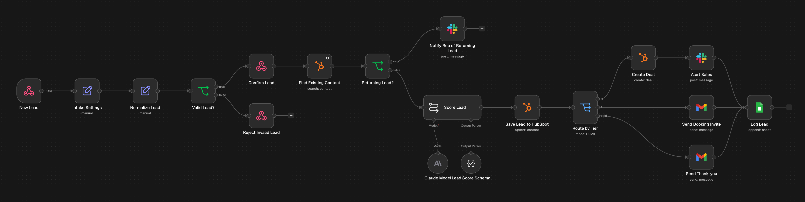
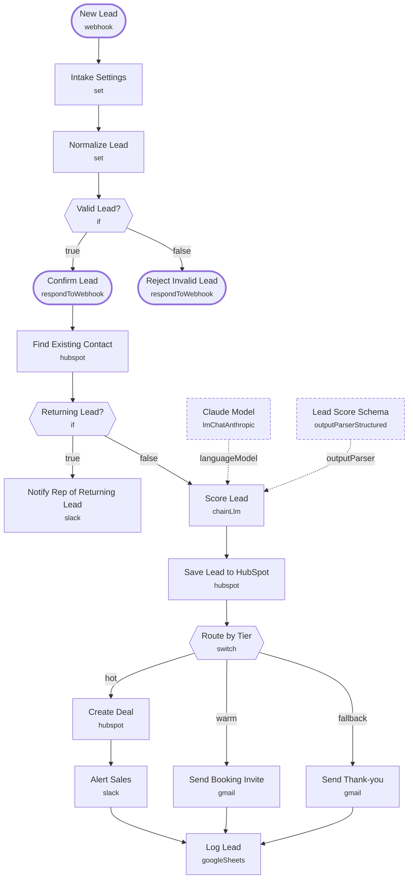

# AI Lead Intake & Scoring

<!-- CANVAS:START -->

<!-- CANVAS:END -->

Every website lead is checked against HubSpot, scored 0 to 100 by Claude against your ideal client, saved to HubSpot, and routed: hot leads get a deal and a Slack alert, warm leads get a booking invite, and cold leads get a polite thank-you.

Built for professional-services firms that get a mix of great leads, tyre-kickers and spam through one contact form.

## What it does

1. **New Lead** (Webhook) receives the form, and **Intake Settings** (Set) holds your business name, ideal-client description and booking link.
2. **Normalize Lead** (Set) cleans the fields. **Valid Lead?** (If) sends bad emails to **Reject Invalid Lead** (400); good ones get **Confirm Lead** (Respond to Webhook).
3. **Find Existing Contact** (HubSpot) looks the email up. **Returning Lead?** (If) sends known contacts to **Notify Rep of Returning Lead** (Slack) instead of scoring them again.
4. **Score Lead** (Basic LLM Chain with **Claude Model** and **Lead Score Schema**) returns a score, tier, need, reason and suggested next step.
5. **Save Lead to HubSpot** (HubSpot) upserts the contact, then **Route by Tier** (Switch) splits three ways:
   - Hot: **Create Deal** (HubSpot) and **Alert Sales** (Slack) to `#sales`.
   - Warm: **Send Booking Invite** (Gmail) with your booking link.
   - Cold: **Send Thank-you** (Gmail).
6. **Log Lead** (Google Sheets) records the score and reason for every lead.

## Sample request

```bash
curl -X POST https://YOUR-N8N/webhook/lead-intake \
  -H "Content-Type: application/json" \
  -d '{"firstName":"Dana","lastName":"Whitfield","email":"dana@whitfieldcpa.com","company":"Whitfield CPA","website":"https://whitfieldcpa.com","teamSize":"35","budget":"$10k","message":"We want to automate client intake and document collection before tax season."}'
```

## Setup (about 15 minutes)

1. **Intake Settings** — describe your ideal client in plain words; Claude scores against it. Set the booking link and sender name.
2. **Anthropic** — connect an account on **Claude Model**.
3. **HubSpot** — connect an account on **Find Existing Contact**, **Save Lead to HubSpot** and **Create Deal**, and set the deal stage on **Create Deal** to your pipeline's first stage.
4. **Slack** — connect an account on **Alert Sales** and **Notify Rep of Returning Lead** (currently `#sales`).
5. **Gmail** — connect an account on **Send Booking Invite** and **Send Thank-you**.
6. **Google Sheets** — connect an account on **Log Lead** and replace the placeholder document ID (`REPLACE_WITH_SPREADSHEET_ID`).
7. **Error handling** — import [Workflow Error Handler](../workflow_error_handler) first, then select it under *Workflow settings → Error workflow* (shipped as `REPLACE_WITH_ERROR_WORKFLOW_ID`).

---

<!-- ARCHITECTURE:START -->
## Architecture



> Shapes: rounded = trigger, hexagon = branch point. Dashed borders mark AI sub-nodes; dotted edges are the model, memory and tool connections feeding an agent. Faded nodes are disabled in this export.
<!-- ARCHITECTURE:END -->
