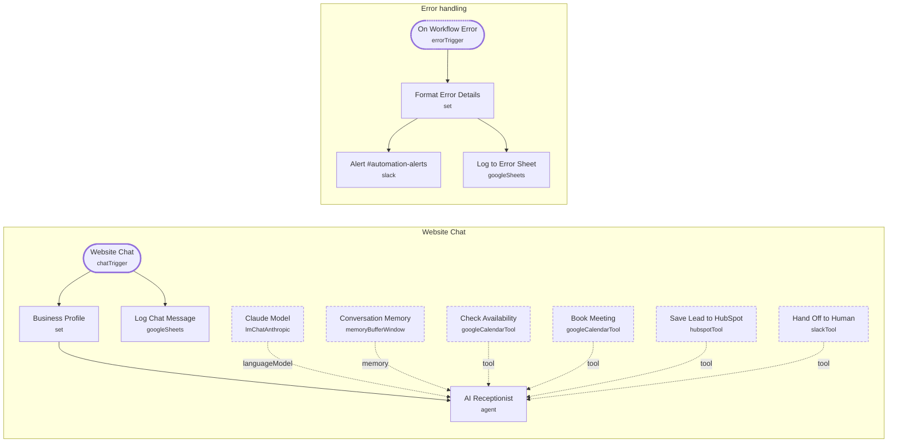

# AI Receptionist (Website Chat)

<!-- CANVAS:START -->

<!-- CANVAS:END -->

A website chat assistant that answers questions from your business profile, saves visitors to HubSpot, checks real Google Calendar availability and books meetings with an invite. When it is unsure, or the visitor asks for a person, it hands off to your team in Slack.

Built for small service firms that want 24/7 lead capture and booking without paying a receptionist or answering-service.

## What it does

1. **Website Chat** (Chat Trigger, public with streaming replies) receives each message, and **Business Profile** (Set) adds your name, time zone, bookable hours and FAQ.
2. **AI Receptionist** (AI Agent with **Claude Model**) answers using per-session **Conversation Memory** and four tools:
   - **Check Availability** (Google Calendar) finds free slots.
   - **Book Meeting** (Google Calendar) creates the event and invite.
   - **Save Lead to HubSpot** (HubSpot) creates or updates the contact.
   - **Hand Off to Human** (Slack) alerts `#website-chat` when the visitor wants a person or the agent is unsure.
3. The system prompt keeps it safe: answer only from the profile, never quote prices, no legal or tax advice, check the exact slot and get a clear yes before booking.
4. **Log Chat Message** (Google Sheets) records every visitor message on a parallel branch, so logging never slows or breaks the reply.
5. **On Workflow Error** (Error Trigger) feeds **Format Error Details**, which posts to `#automation-alerts` and writes a row to the error sheet.

## Sample request

Open the hosted chat URL from the **Website Chat** node, or embed it on your site:

```html
<link href="https://cdn.jsdelivr.net/npm/@n8n/chat/dist/style.css" rel="stylesheet" />
<script type="module">
  import { createChat } from 'https://cdn.jsdelivr.net/npm/@n8n/chat/dist/chat.bundle.es.js';
  createChat({ webhookUrl: 'https://YOUR-N8N/webhook/CHAT-ID/chat' });
</script>
```

## Setup (about 15 minutes)

1. **Business Profile** — replace the FAQ, hours and time zone with your own.
2. **Anthropic** — connect an account on **Claude Model**.
3. **Google Calendar** — connect an account on **Check Availability** and **Book Meeting**, and pick your calendar in both (currently set to `primary`).
4. **HubSpot** — connect an account on **Save Lead to HubSpot**.
5. **Slack** — connect an account on **Hand Off to Human** and **Alert #automation-alerts**, and create `#website-chat` and `#automation-alerts`.
6. **Google Sheets** — connect an account on **Log Chat Message** and **Log to Error Sheet**, and replace the placeholder document IDs (`REPLACE_WITH_SPREADSHEET_ID`) with your own sheets.
7. Activate the workflow, then embed the chat snippet above.

---

<!-- ARCHITECTURE:START -->
## Architecture



> Shapes: rounded = trigger, hexagon = branch point. Dashed borders mark AI sub-nodes; dotted edges are the model, memory and tool connections feeding an agent. Faded nodes are disabled in this export.
<!-- ARCHITECTURE:END -->
