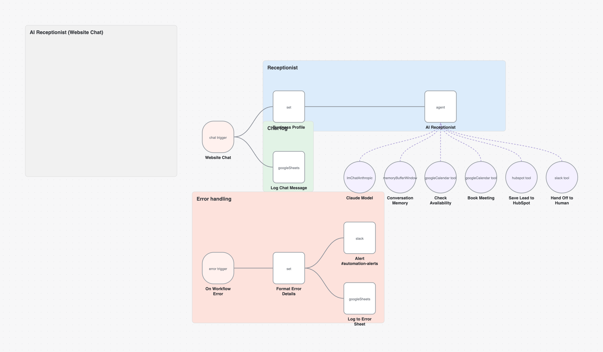
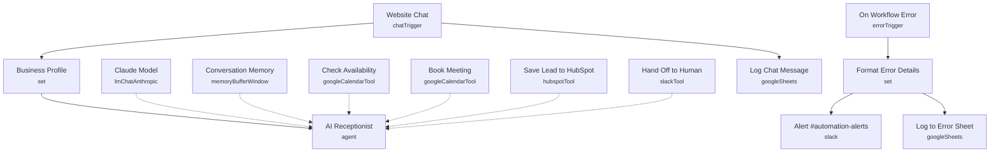

# AI Receptionist (Website Chat)

<!-- CANVAS:START -->

<!-- CANVAS:END -->

A website chat assistant that answers questions from your business profile, saves visitors to HubSpot, checks real Google Calendar availability and books meetings with an invite. When it is unsure, or the visitor asks for a person, it hands off to your team in Slack.

Built for small service firms that want 24/7 lead capture and booking without paying a receptionist or answering-service.

## What it does

1. **Website Chat** (public n8n chat, streaming replies) receives each message. **Business Profile** adds name, time zone, bookable hours and an FAQ.
2. **AI Receptionist** (Claude) answers with per-session **Conversation Memory** and four tools: **Check Availability**, **Book Meeting**, **Save Lead to HubSpot** and **Hand Off to Human**.
3. Guardrails in the system prompt: answer only from the profile, never quote prices, no legal or tax advice, always check the exact slot and get a clear yes before booking.
4. **Log Chat Message** records every visitor message on a parallel branch, so logging never slows or breaks the reply.
5. **On Workflow Error** posts any failure to `#automation-alerts` and logs it.

## Sample request

Open the hosted chat URL from the **Website Chat** node, or embed it on your site:

```html
<link href="https://cdn.jsdelivr.net/npm/@n8n/chat/dist/style.css" rel="stylesheet" />
<script type="module">
  import { createChat } from 'https://cdn.jsdelivr.net/npm/@n8n/chat/dist/chat.bundle.es.js';
  createChat({ webhookUrl: 'https://YOUR-N8N/webhook/CHAT-ID/chat' });
</script>
```

## Setup

1. **Business Profile**: replace the FAQ, hours and time zone with your own.
2. Connect **Anthropic**, **Google Calendar** (pick your calendar in both calendar tools), **HubSpot**, **Slack** and **Google Sheets**.
3. Create `#website-chat` and `#automation-alerts` in Slack.
4. Activate the workflow, then embed the chat snippet above.

Every workflow ships inactive with credential placeholders. Connect your own accounts, run one test, then activate.

---

<!-- ARCHITECTURE:START -->
## Architecture


<!-- ARCHITECTURE:END -->
