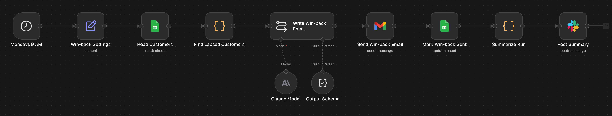
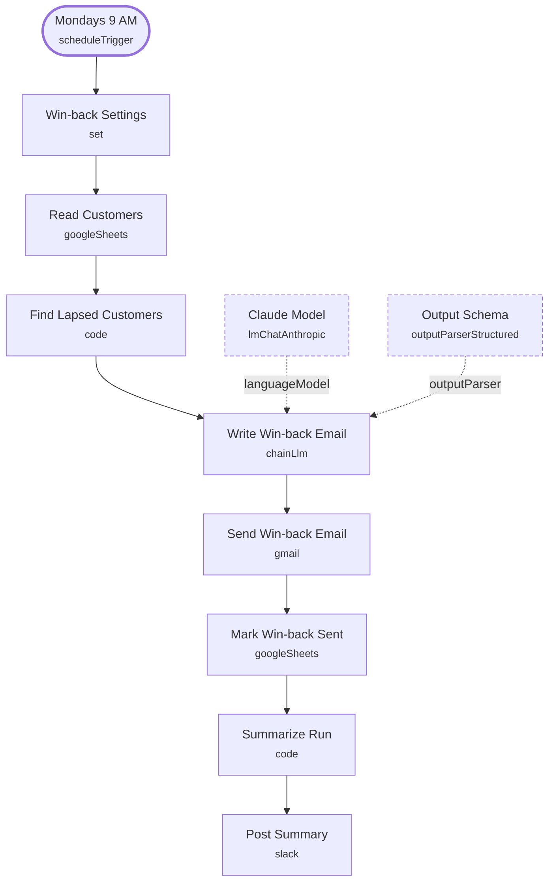

# Churn-Risk Win-back

<!-- CANVAS:START -->

<!-- CANVAS:END -->

Every Monday it finds customers who have not ordered in 60 days, has Claude write a short personal win-back email with your offer code, sends it, marks the customer so they are not emailed again for 90 days, and posts a summary in Slack.

Built for e-commerce stores and repeat-purchase service businesses. Picks up where [Abandoned Cart Recovery Engine](../abandoned_cart_recovery_engine) stops: lapsed customers rather than open carts.

## What it does

1. **Mondays 9 AM** (Schedule Trigger) starts the run, and **Win-back Settings** (Set) holds the inactive-day threshold, weekly cap, offer, code and shop link.
2. **Read Customers** (Google Sheets) reads the customer list.
3. **Find Lapsed Customers** (Code) keeps customers with no order for 60 to 365 days who have not had a win-back email in 90 days, highest spenders first, up to the weekly cap.
4. **Write Win-back Email** (Basic LLM Chain, with **Claude Model** and **Output Schema**) writes a subject and body based on each customer's history and favourite product.
5. **Send Win-back Email** (Gmail) sends it, and **Mark Win-back Sent** (Google Sheets) stamps the date and code on the customer row.
6. **Summarize Run** (Code) totals the run, and **Post Summary** (Slack) posts it to `#marketing`.

## Sample request

Not applicable — this workflow runs on a schedule and reads from a Google Sheet of customers rather than an inbound request.

## Setup (about 10 minutes)

1. **Google Sheets** — connect an account on **Read Customers** and **Mark Win-back Sent**, and replace the placeholder document ID (`REPLACE_WITH_SPREADSHEET_ID`) with a sheet with the columns `name`, `email`, `lastOrderDate`, `orderCount`, `totalSpent`, `favoriteProduct`, `winbackSentAt`, `winbackCode`. Export it from Shopify, WooCommerce or your POS.
2. **Win-back Settings** — set the threshold, cap, offer, code and shop link, and create the discount code in your store.
3. **Anthropic** — connect an account on **Claude Model**.
4. **Gmail** — connect an account on **Send Win-back Email**.
5. **Slack** — connect an account on **Post Summary** and point it at your own channel (currently `#marketing`).
6. **Error handling** — import [Workflow Error Handler](../workflow_error_handler) first, then select it under *Workflow settings → Error workflow* (shipped as `REPLACE_WITH_ERROR_WORKFLOW_ID`).

---

<!-- ARCHITECTURE:START -->
## Architecture

> Shapes: rounded = trigger, hexagon = branch point. Dashed borders mark AI sub-nodes; dotted edges are the model, memory and tool connections feeding an agent. Faded nodes are disabled in this export.
<!-- ARCHITECTURE:END -->
