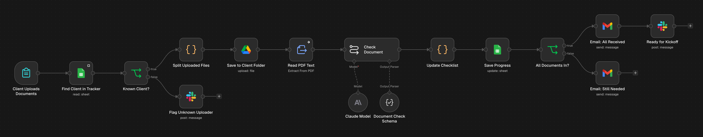
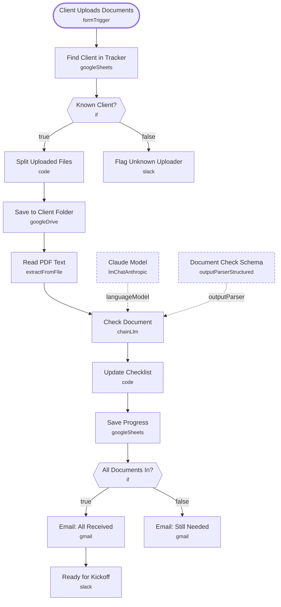

# Client Document Upload Check

<!-- CANVAS:START -->

<!-- CANVAS:END -->

Clients upload their onboarding documents through a hosted n8n form. Each file is saved to the client's Drive folder, read and matched to their checklist by Claude, and the tracker is updated. The client gets an email saying what is still needed, and the team hears when everything is in.

The second step of [Client Onboarding Kickoff](../client_onboarding_kickoff), for firms collecting documents from new clients.

## What it does

1. **Client Uploads Documents** (Form Trigger) hosts the upload page at `/form/client-documents`.
2. **Find Client in Tracker** (Google Sheets) looks up the email. **Known Client?** (If) sends unknown addresses to **Flag Unknown Uploader** (Slack).
3. **Split Uploaded Files** (Code) makes one item per file, and **Save to Client Folder** (Google Drive) files each one.
4. **Read PDF Text** (Extract from File) reads the first pages; images pass through without text.
5. **Check Document** (Basic LLM Chain with **Claude Model** and **Document Check Schema**) matches each file to one checklist item and flags unreadable or wrong files.
6. **Update Checklist** (Code) removes what arrived, and **Save Progress** (Google Sheets) writes the new list and status back to the tracker.
7. **All Documents In?** (If) splits two ways:
   - Yes: **Email: All Received** (Gmail) thanks the client and **Ready for Kickoff** (Slack) tells the team.
   - No: **Email: Still Needed** (Gmail) lists what is missing and any problem files.

## Sample request

Open the hosted form URL from **Client Uploads Documents**. The welcome email from [Client Onboarding Kickoff](../client_onboarding_kickoff) links to it with the client's email filled in.

## Setup (about 10 minutes)

1. **Google Sheets** — connect an account on **Find Client in Tracker** and **Save Progress**, and use the same **Onboarding Tracker** sheet as Client Onboarding Kickoff (`REPLACE_WITH_SPREADSHEET_ID`).
2. **Google Drive** — connect an account on **Save to Client Folder**.
3. **Anthropic** — connect an account on **Claude Model**.
4. **Gmail** — connect an account on both email nodes.
5. **Slack** — connect an account on **Ready for Kickoff** and **Flag Unknown Uploader** (currently `#onboarding`).
6. **Error handling** — import [Workflow Error Handler](../workflow_error_handler) first, then select it under *Workflow settings → Error workflow* (shipped as `REPLACE_WITH_ERROR_WORKFLOW_ID`).
7. Activate the workflow and copy the production form URL into **Onboarding Settings** of Client Onboarding Kickoff.

---

<!-- ARCHITECTURE:START -->
## Architecture

> Shapes: rounded = trigger, hexagon = branch point. Dashed borders mark AI sub-nodes; dotted edges are the model, memory and tool connections feeding an agent. Faded nodes are disabled in this export.
<!-- ARCHITECTURE:END -->
