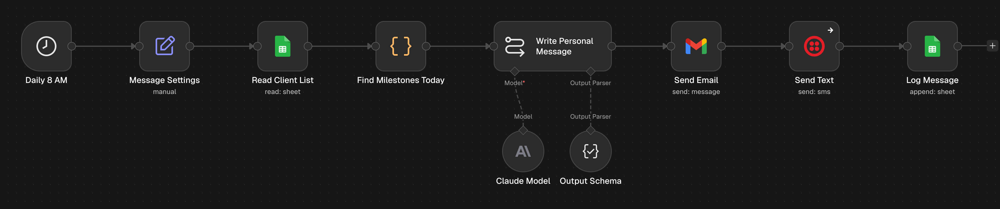
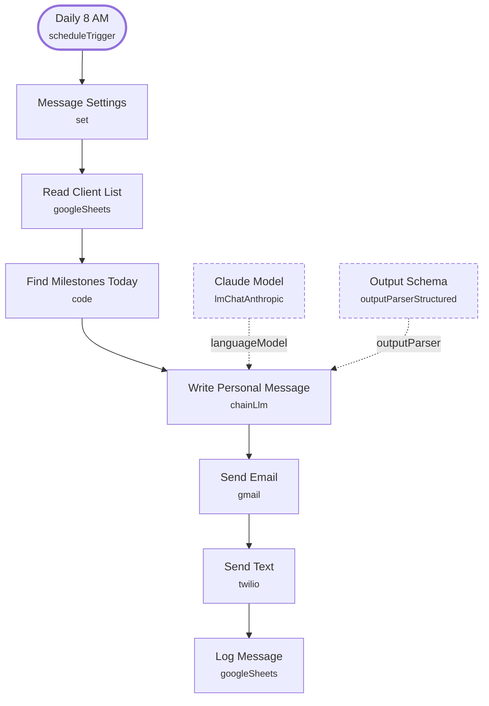

# Client Birthday & Home Anniversary Messages

<!-- CANVAS:START -->

<!-- CANVAS:END -->

Every morning it checks your client list for birthdays and home (or policy) anniversaries, has Claude write a short personal note for each one, then sends it by email and text and logs it.

Built for realtors, mortgage brokers, insurance agents and financial advisors who live on repeat business and referrals.

## What it does

1. **Daily 8 AM** (Schedule Trigger) starts the run, and **Message Settings** (Set) holds your business name, default agent and SMS number.
2. **Read Client List** (Google Sheets) reads every client.
3. **Find Milestones Today** (Code) keeps clients whose birthday or closing date falls on today, and works out how many years it has been.
4. **Write Personal Message** (Basic LLM Chain, with **Claude Model** and **Output Schema**) writes a subject, a short email and a text in the agent's voice.
5. **Send Email** (Gmail) and **Send Text** (Twilio) deliver it.
6. **Log Message** (Google Sheets) records what was sent on the `Messages` tab.

## Sample request

Not applicable — this workflow runs on a schedule and reads from a Google Sheet of past clients rather than an inbound request.

## Setup (about 10 minutes)

1. **Google Sheets** — connect an account on **Read Client List** and **Log Message**, and replace the placeholder document ID (`REPLACE_WITH_SPREADSHEET_ID`) with a sheet with a client tab (`name`, `email`, `phone`, `birthday`, `closeDate`, `propertyAddress`, `agent`, `notes`) and a `Messages` tab. Dates use `YYYY-MM-DD`.
2. **Message Settings** — set your business name, agent name and Twilio number.
3. **Anthropic** — connect an account on **Claude Model**.
4. **Gmail** — connect an account on **Send Email**.
5. **Twilio** — connect an account on **Send Text**. Clients without a phone number only get the email.
6. **Error handling** — import [Workflow Error Handler](../workflow_error_handler) first, then select it under *Workflow settings → Error workflow* (shipped as `REPLACE_WITH_ERROR_WORKFLOW_ID`).

---

<!-- ARCHITECTURE:START -->
## Architecture

> Shapes: rounded = trigger, hexagon = branch point. Dashed borders mark AI sub-nodes; dotted edges are the model, memory and tool connections feeding an agent. Faded nodes are disabled in this export.
<!-- ARCHITECTURE:END -->
