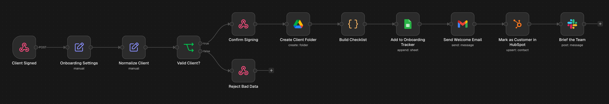
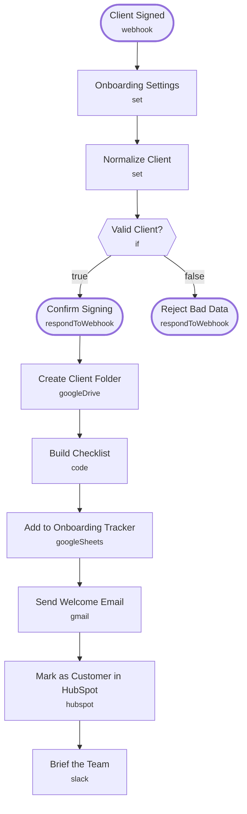

# Client Onboarding Kickoff

<!-- CANVAS:START -->

<!-- CANVAS:END -->

When a client signs, it creates their Google Drive folder, builds a document checklist for the service they bought, adds them to an onboarding tracker, sends a welcome email with an upload link and kickoff booking link, marks them a customer in HubSpot and briefs the team in Slack.

Built for accounting, bookkeeping and advisory firms where every new client means the same folder, email and checklist by hand. Works with [Client Document Upload Check](../client_document_upload_check) and [Missing Document Chaser](../missing_document_chaser), which share the same tracker sheet.

## What it does

1. **Client Signed** (Webhook) receives the signed client from your e-signature or CRM tool, and **Onboarding Settings** (Set) holds the clients folder, upload form link and kickoff booking link.
2. **Normalize Client** (Set) cleans the fields. **Valid Client?** (If) needs a client name and valid email, sending bad data to **Reject Bad Data** (400). **Confirm Signing** (Respond to Webhook) answers right away.
3. **Create Client Folder** (Google Drive) makes `<Client> - Onboarding` inside your clients folder.
4. **Build Checklist** (Code) picks the documents for the service (bookkeeping, tax or payroll) and builds a personal upload link.
5. **Add to Onboarding Tracker** (Google Sheets) adds a row with status `waiting` and the missing documents.
6. **Send Welcome Email** (Gmail) lists the documents with the upload link and kickoff booking link, **Mark as Customer in HubSpot** (HubSpot) updates the lifecycle stage and **Brief the Team** (Slack) posts to `#onboarding`.

## Sample request

```bash
curl -X POST https://YOUR-N8N/webhook/client-signed \
  -H "Content-Type: application/json" \
  -d '{"clientName":"Whitfield CPA","contactName":"Dana Whitfield","email":"dana@whitfieldcpa.com","service":"bookkeeping","accountManager":"Sam"}'
```

## Setup (about 15 minutes)

1. **Onboarding Settings** — set the Drive folder ID for client folders, the upload form URL from [Client Document Upload Check](../client_document_upload_check), and your kickoff booking link.
2. **Build Checklist** — edit the document lists per service to match your firm.
3. **Google Drive** — connect an account on **Create Client Folder**.
4. **Google Sheets** — create an **Onboarding Tracker** sheet with headers `signedAt, clientName, contactName, email, service, folderId, missingDocs, status, reminderCount, lastReminder`, connect an account on **Add to Onboarding Tracker** and replace the placeholder document ID (`REPLACE_WITH_SPREADSHEET_ID`).
5. **Gmail** — connect an account on **Send Welcome Email**.
6. **HubSpot** — connect an account on **Mark as Customer in HubSpot**.
7. **Slack** — connect an account on **Brief the Team** (currently `#onboarding`).
8. **Error handling** — import [Workflow Error Handler](../workflow_error_handler) first, then select it under *Workflow settings → Error workflow* (shipped as `REPLACE_WITH_ERROR_WORKFLOW_ID`).

---

<!-- ARCHITECTURE:START -->
## Architecture



> Shapes: rounded = trigger, hexagon = branch point. Dashed borders mark AI sub-nodes; dotted edges are the model, memory and tool connections feeding an agent. Faded nodes are disabled in this export.
<!-- ARCHITECTURE:END -->
