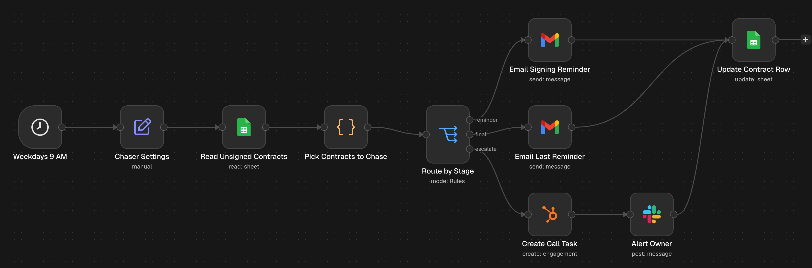
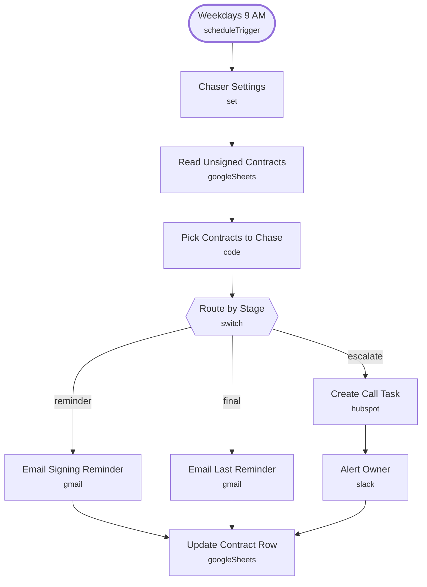

# Contract Signature Chaser

<!-- CANVAS:START -->

<!-- CANVAS:END -->

Every weekday it checks a tracker of contracts sent for e-signature. Unsigned contracts get a reminder on day 2 and day 4 and a last reminder on day 7; on day 9 the workflow creates a HubSpot call task and alerts the owner in Slack.

Built for agencies, consultants, real estate teams and law firms whose deals stall between "yes" and the signature. Works with DocuSign, PandaDoc, Dropbox Sign or any tool that gives you a signing link.

## What it does

1. **Weekdays 9 AM** (Schedule Trigger) starts the run, and **Chaser Settings** (Set) holds the sender name.
2. **Read Unsigned Contracts** (Google Sheets) reads rows whose `status` is `sent`. Set it to `signed` (by hand or from your e-sign tool) and reminders stop.
3. **Pick Contracts to Chase** (Code) keeps contracts sent 2, 4, 7 or 9 days ago and sets the stage.
4. **Route by Stage** (Switch) sends each contract down one path:
   - **Email Signing Reminder** (Gmail) on days 2 and 4.
   - **Email Last Reminder** (Gmail) on day 7.
   - **Create Call Task** (HubSpot), then **Alert Owner** (Slack) posts to `#sales` on day 9.
5. **Update Contract Row** (Google Sheets) records the last reminder and its date.

## Sample request

Not applicable — this workflow runs on a schedule and reads from a Google Sheet of sent contracts rather than an inbound request.

## Setup (about 10 minutes)

1. **Google Sheets** — connect an account on **Read Unsigned Contracts** and **Update Contract Row**, and replace the placeholder document ID (`REPLACE_WITH_SPREADSHEET_ID`) with a sheet with the columns `clientName`, `email`, `contractName`, `signLink`, `sentDate`, `status`, `ownerEmail`, `lastReminder`, `lastReminderDate`.
2. **Chaser Settings** — set your sender name.
3. **Gmail** — connect an account on the two reminder nodes.
4. **HubSpot** — connect an account on **Create Call Task**.
5. **Slack** — connect an account on **Alert Owner** and point it at your own channel (currently `#sales`).
6. **Error handling** — import [Workflow Error Handler](../workflow_error_handler) first, then select it under *Workflow settings → Error workflow* (shipped as `REPLACE_WITH_ERROR_WORKFLOW_ID`).

---

<!-- ARCHITECTURE:START -->
## Architecture

> Shapes: rounded = trigger, hexagon = branch point. Dashed borders mark AI sub-nodes; dotted edges are the model, memory and tool connections feeding an agent. Faded nodes are disabled in this export.
<!-- ARCHITECTURE:END -->
