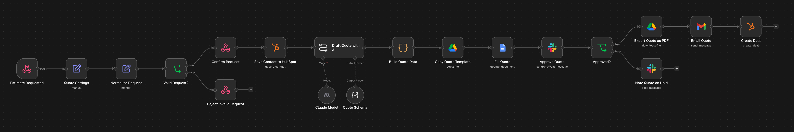
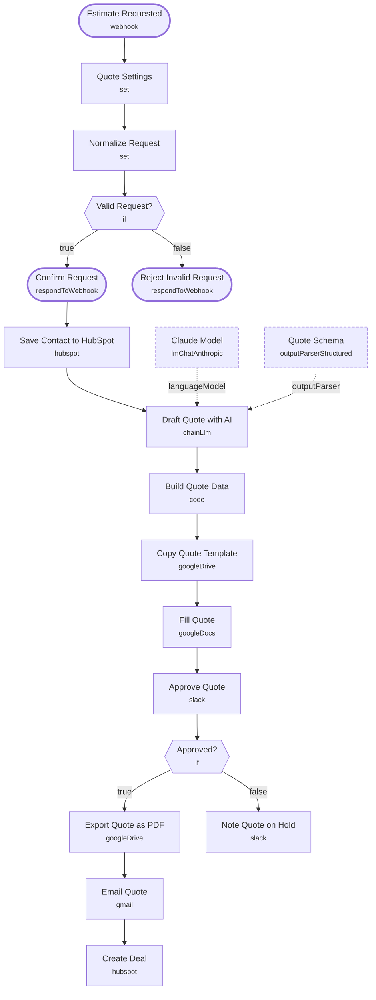

# Estimate Request to AI Quote

<!-- CANVAS:START -->

<!-- CANVAS:END -->

When a customer asks for an estimate, Claude prices the job from your own price book, the quote is filled into a Google Docs template, and the owner approves it in Slack. Approved quotes are emailed as a PDF and a HubSpot deal is created. Jobs too vague to price get a site-visit booking link.

Built for contractors, landscapers and home-service businesses that lose jobs because quotes take days.

## What it does

1. **Estimate Requested** (Webhook) receives the request, and **Quote Settings** (Set) holds your price book, template, output folder and site-visit link.
2. **Normalize Request** (Set) cleans the fields. **Valid Request?** (If) needs an email and job details, sending bad requests to **Reject Invalid Request** (400). **Confirm Request** (Respond to Webhook) answers right away.
3. **Save Contact to HubSpot** (HubSpot) upserts the customer.
4. **Draft Quote with AI** (Basic LLM Chain with **Claude Model** and **Quote Schema**) builds line items only from your price book, lists its assumptions and flags jobs that need a site visit.
5. **Build Quote Data** (Code) formats the money and dates, then **Copy Quote Template** (Google Drive) and **Fill Quote** (Google Docs) create the document.
6. **Approve Quote** (Slack) posts the quote to `#estimates` and waits up to 2 days. **Approved?** (If) splits two ways:
   - Approved: **Export Quote as PDF** (Google Drive), **Email Quote** (Gmail) with the PDF attached, and **Create Deal** (HubSpot).
   - Not approved: **Note Quote on Hold** (Slack) links the draft for manual editing.

## Sample request

```bash
curl -X POST https://YOUR-N8N/webhook/estimate-request \
  -H "Content-Type: application/json" \
  -d '{"name":"Chris Patel","email":"chris@example.com","phone":"(619) 555-0188","address":"412 Elm St, San Diego","service":"Spring cleanup","details":"Front and back beds, about 600 sq ft total, need weeding, trimming 10 shrubs and fresh mulch."}'
```

Template placeholders: `{{customer_name}}`, `{{address}}`, `{{scope}}`, `{{line_items}}`, `{{total}}`, `{{assumptions}}`, `{{quote_date}}`, `{{valid_until}}`.

## Setup (about 20 minutes)

1. **Quote Settings** — replace the sample price book with your own prices, and set the template doc ID, output folder ID, site-visit link and deal stage ID.
2. **Google Docs template** — create a quote template with the placeholders above.
3. **Anthropic** — connect an account on **Claude Model**.
4. **HubSpot** — connect an account on **Save Contact to HubSpot** and **Create Deal**.
5. **Google Drive** and **Google Docs** — connect accounts on **Copy Quote Template**, **Export Quote as PDF** and **Fill Quote**.
6. **Slack** — connect an account on **Approve Quote** and **Note Quote on Hold** (currently `#estimates`).
7. **Gmail** — connect an account on **Email Quote**.
8. **Error handling** — import [Workflow Error Handler](../workflow_error_handler) first, then select it under *Workflow settings → Error workflow* (shipped as `REPLACE_WITH_ERROR_WORKFLOW_ID`).

---

<!-- ARCHITECTURE:START -->
## Architecture



> Shapes: rounded = trigger, hexagon = branch point. Dashed borders mark AI sub-nodes; dotted edges are the model, memory and tool connections feeding an agent. Faded nodes are disabled in this export.
<!-- ARCHITECTURE:END -->
