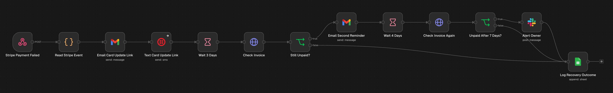
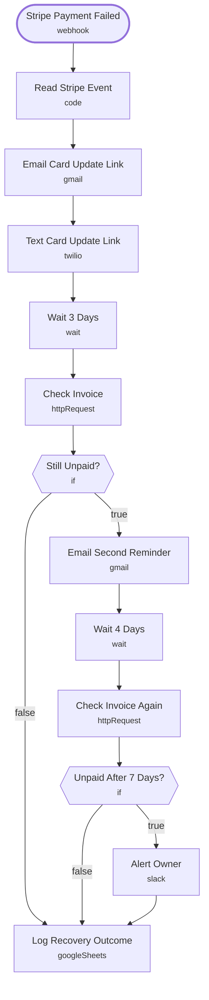

# Failed Payment Recovery

<!-- CANVAS:START -->

<!-- CANVAS:END -->

When Stripe reports a failed payment, the customer gets an email and a text with a link to update their card. After 3 days the workflow checks the invoice in Stripe and sends a firmer reminder if it is still unpaid; after 7 days it alerts the owner in Slack. Every case is logged as recovered or escalated.

Built for SaaS, membership, gym and subscription businesses where expired cards quietly cancel paying customers.

## What it does

1. **Stripe Payment Failed** (Webhook) receives Stripe's `invoice.payment_failed` event.
2. **Read Stripe Event** (Code) only continues on the first failed attempt (Stripe sends one per retry) and pulls out the customer, amount and hosted payment link.
3. **Email Card Update Link** (Gmail) and **Text Card Update Link** (Twilio) send the update-card link.
4. **Wait 3 Days** (Wait), then **Check Invoice** (HTTP Request) reads the invoice from the Stripe API.
5. **Still Unpaid?** (If) sends **Email Second Reminder** (Gmail) if it is still open; paid or void invoices go straight to the log.
6. **Wait 4 Days** (Wait), **Check Invoice Again** (HTTP Request) and **Unpaid After 7 Days?** (If) decide whether **Alert Owner** (Slack) posts to `#billing`.
7. **Log Recovery Outcome** (Google Sheets) records each invoice as recovered or escalated.

## Sample request

Stripe sends this event itself. To test, use the Stripe CLI:

```bash
stripe trigger invoice.payment_failed
```

## Setup (about 15 minutes)

1. **Stripe webhook** — in Stripe, add the webhook URL from **Stripe Payment Failed** and subscribe it to `invoice.payment_failed`.
2. **Read Stripe Event** — set your business name and Twilio number.
3. **Stripe** — connect an account (secret key) on **Check Invoice** and **Check Invoice Again**.
4. **Gmail** — connect an account on the two email nodes.
5. **Twilio** — connect an account on **Text Card Update Link**. Customers without a phone number skip the text.
6. **Slack** — connect an account on **Alert Owner** and point it at your own channel (currently `#billing`).
7. **Google Sheets** — connect an account on **Log Recovery Outcome** and replace the placeholder document ID (`REPLACE_WITH_SPREADSHEET_ID`) with a log sheet.
8. **Error handling** — import [Workflow Error Handler](../workflow_error_handler) first, then select it under *Workflow settings → Error workflow* (shipped as `REPLACE_WITH_ERROR_WORKFLOW_ID`).

---

<!-- ARCHITECTURE:START -->
## Architecture



> Shapes: rounded = trigger, hexagon = branch point. Dashed borders mark AI sub-nodes; dotted edges are the model, memory and tool connections feeding an agent. Faded nodes are disabled in this export.
<!-- ARCHITECTURE:END -->
