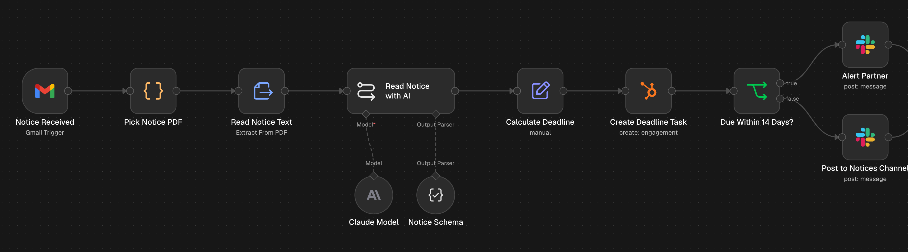
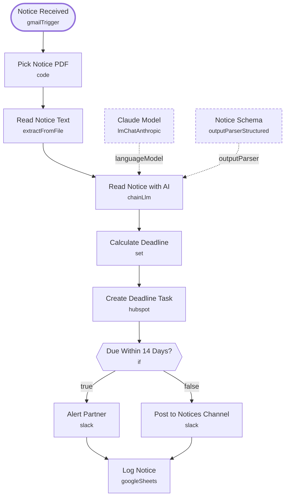

# IRS & State Notice Triage

<!-- CANVAS:START -->

<!-- CANVAS:END -->

When a client's IRS or state tax notice lands in the firm's inbox, Claude reads the PDF, pulls out the agency, notice code, tax year, amount and response deadline, and a HubSpot task is created a week before the deadline. Notices due within 14 days go to the partner as urgent.

Built for CPA firms and tax preparers, where a missed notice deadline costs the client money and the firm its reputation.

## What it does

1. **Notice Received** (Gmail Trigger) checks every 15 minutes for unread emails labeled `tax-notices` with a PDF attached.
2. **Pick Notice PDF** (Code) keeps the PDF and who forwarded it, and **Read Notice Text** (Extract from File) reads up to 6 pages.
3. **Read Notice with AI** (Basic LLM Chain with **Claude Model** and **Notice Schema**) extracts agency, notice code, taxpayer, tax year, amount due, notice date, response deadline, a summary and the next step.
4. **Calculate Deadline** (Set) works out the days left; if no deadline is stated it assumes 30 days.
5. **Create Deadline Task** (HubSpot) adds a task due 7 days before the deadline.
6. **Due Within 14 Days?** (If) splits two ways:
   - Yes: **Alert Partner** (Slack) posts an urgent message to `#tax-notices`.
   - No: **Post to Notices Channel** (Slack) posts a normal summary.
7. **Log Notice** (Google Sheets) records every notice.

## Sample request

Not applicable — this workflow polls Gmail for labeled notices. To test, forward a sample notice PDF to the inbox and apply the `tax-notices` label.

## Setup (about 10 minutes)

1. **Gmail** — connect the firm inbox on **Notice Received**, create a `tax-notices` label and a filter (or ask staff) to apply it to forwarded notices.
2. **Anthropic** — connect an account on **Claude Model**.
3. **HubSpot** — connect an account on **Create Deadline Task**.
4. **Slack** — connect an account on both Slack nodes (currently `#tax-notices`).
5. **Google Sheets** — connect an account on **Log Notice** and replace the placeholder document ID (`REPLACE_WITH_SPREADSHEET_ID`).
6. **Error handling** — import [Workflow Error Handler](../workflow_error_handler) first, then select it under *Workflow settings → Error workflow* (shipped as `REPLACE_WITH_ERROR_WORKFLOW_ID`).

Always have a preparer check the AI reading against the notice before responding.

---

<!-- ARCHITECTURE:START -->
## Architecture

> Shapes: rounded = trigger, hexagon = branch point. Dashed borders mark AI sub-nodes; dotted edges are the model, memory and tool connections feeding an agent. Faded nodes are disabled in this export.
<!-- ARCHITECTURE:END -->
