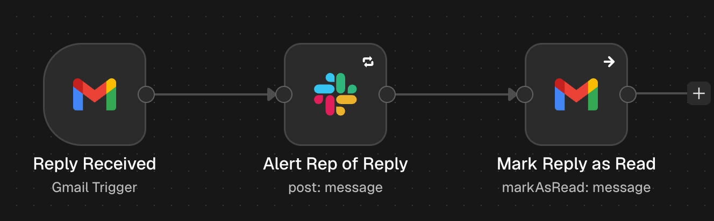
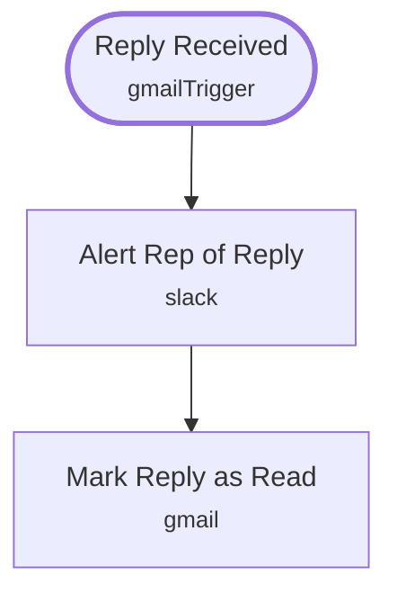

# Lead Revival Reply Alert

<!-- CANVAS:START -->

<!-- CANVAS:END -->

Watches your inbox for replies to revival emails and posts each one to Slack so the rep can follow up while the lead is warm.

The second half of [Old Lead Revival](../old_lead_revival), for teams re-engaging cold HubSpot leads by email.

## What it does

1. **Reply Received** (Gmail Trigger) polls every 15 minutes for unread replies to revival emails.
2. **Alert Rep of Reply** (Slack) posts the sender, subject and snippet.
3. **Mark Reply as Read** (Gmail) marks the email read so it is not alerted twice.

## Sample request

Not applicable — this workflow polls Gmail every 15 minutes rather than receiving an inbound request.

## Setup (about 5 minutes)

1. **Gmail** — connect the same account as **Send Revival Email** on **Reply Received** and **Mark Reply as Read**.
2. **Slack** — connect an account on **Alert Rep of Reply** (currently `#lead-revival`).
3. **Error handling** — import [Workflow Error Handler](../workflow_error_handler) first, then select it under *Workflow settings → Error workflow* (shipped as `REPLACE_WITH_ERROR_WORKFLOW_ID`).

---

<!-- ARCHITECTURE:START -->
## Architecture

> Shapes: rounded = trigger, hexagon = branch point. Dashed borders mark AI sub-nodes; dotted edges are the model, memory and tool connections feeding an agent. Faded nodes are disabled in this export.
<!-- ARCHITECTURE:END -->
