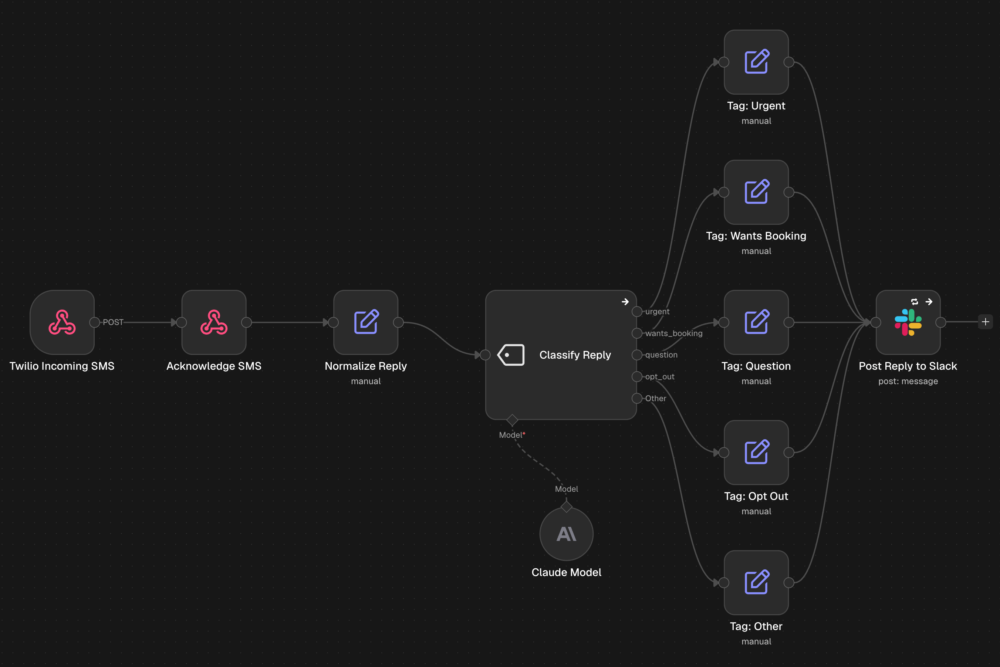
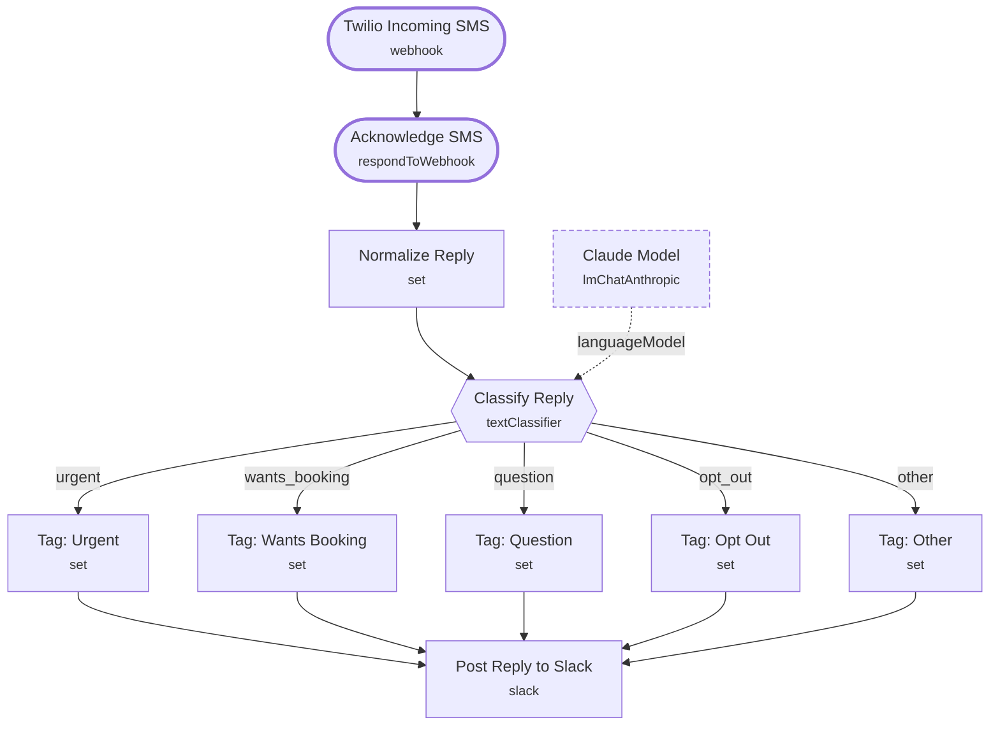

# Missed-Call Reply Classifier

<!-- CANVAS:START -->

<!-- CANVAS:END -->

When someone texts back after a missed-call text, AI sorts the reply into urgent, wants to book, question, opt-out or other, and posts it to Slack with a clear label so the team knows who to call first.

The second half of [Missed-Call Text Back](../missed_call_text_back), for offices that send missed-call texts from a Twilio number.

## What it does

1. **Twilio Incoming SMS** (Webhook) receives the text, and **Acknowledge SMS** (Respond to Webhook) sends Twilio an empty TwiML reply.
2. **Normalize Reply** (Set) pulls out the sender and message body.
3. **Classify Reply** (Text Classifier with **Claude Model**) sorts it into one of five categories.
4. A tag node (**Tag: Urgent**, **Tag: Wants Booking**, **Tag: Question**, **Tag: Opt Out** or **Tag: Other**) adds the label, then **Post Reply to Slack** (Slack) shows it to the team.

## Sample request

Twilio sends this automatically. To test by hand:

```bash
curl -X POST https://YOUR-N8N/webhook/missed-call-reply \
  -d "From=+16195550142" -d "Body=Can someone call me about a tax notice? It is due Friday."
```

## Setup (about 5 minutes)

1. **Twilio** — in the Twilio console, set *A message comes in* on your number to the `missed-call-reply` URL.
2. **Anthropic** — connect an account on **Claude Model**.
3. **Slack** — connect an account on **Post Reply to Slack** (currently `#missed-calls`).
4. **Error handling** — import [Workflow Error Handler](../workflow_error_handler) first, then select it under *Workflow settings → Error workflow* (shipped as `REPLACE_WITH_ERROR_WORKFLOW_ID`).

---

<!-- ARCHITECTURE:START -->
## Architecture



> Shapes: rounded = trigger, hexagon = branch point. Dashed borders mark AI sub-nodes; dotted edges are the model, memory and tool connections feeding an agent. Faded nodes are disabled in this export.
<!-- ARCHITECTURE:END -->
