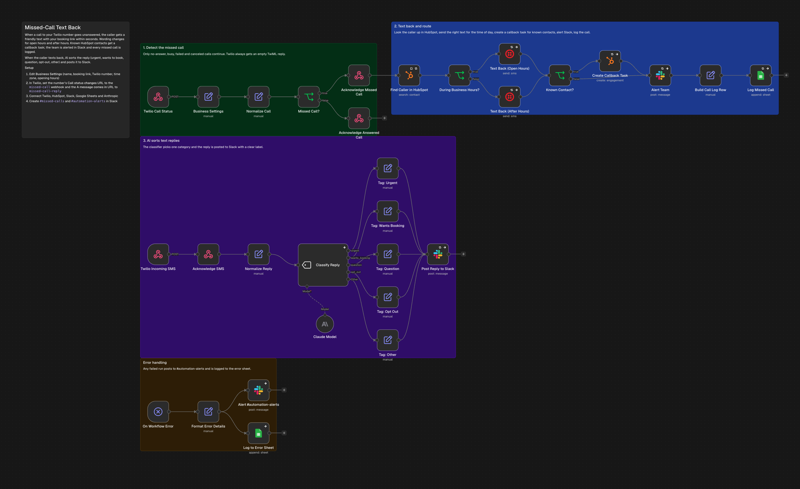
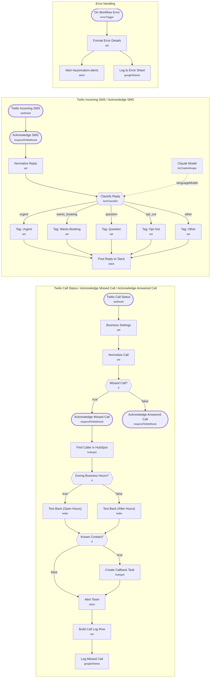

# Missed-Call Text Back

<!-- CANVAS:START -->

<!-- CANVAS:END -->

When a call to your Twilio number goes unanswered, the caller gets a friendly text with your booking link within seconds, worded differently for open hours and after hours. Known HubSpot contacts get a callback task, the team is alerted in Slack, and when the caller texts back, AI sorts the reply before posting it.

Built for offices that miss calls while with clients: CPA firms in tax season, insurance agencies, home-service and real estate teams.

## What it does

1. **Twilio Call Status** receives Twilio's status callback. **Business Settings** holds your name, booking link, number, time zone and opening hours.
2. **Normalize Call** extracts the caller and works out whether the call came in during business hours. **Missed Call?** only lets no-answer, busy, failed and canceled calls continue. Twilio always gets an empty TwiML reply.
3. **Find Caller in HubSpot** searches phone and mobile phone. **During Business Hours?** picks **Text Back (Open Hours)** or **Text Back (After Hours)**.
4. **Known Contact?** creates a **Create Callback Task** (due in 30 minutes, or 9 AM next day after hours). **Alert Team** posts to `#missed-calls` either way, and **Log Missed Call** writes a sheet row.
5. **Twilio Incoming SMS** catches replies. **Classify Reply** (Claude) sorts each one into urgent, wants to book, question, opt-out or other, and **Post Reply to Slack** shows it with a clear label.
6. **On Workflow Error** posts any failure to `#automation-alerts` and logs it.

## Sample request

Twilio sends these automatically. To test by hand:

```bash
curl -X POST https://YOUR-N8N/webhook/missed-call \
  -d "CallSid=CA123" -d "CallStatus=no-answer" -d "From=+16195550142" -d "To=+15555550100"

curl -X POST https://YOUR-N8N/webhook/missed-call-reply \
  -d "From=+16195550142" -d "Body=Can someone call me about a tax notice? It is due Friday."
```

## Setup

1. **Business Settings**: business name, booking link, Twilio number, IANA time zone, open and close hour.
2. **Twilio console**: on your number set *Call status changes* to the `missed-call` URL and *A message comes in* to `missed-call-reply`.
3. Connect **Twilio**, **HubSpot**, **Slack**, **Google Sheets** and **Anthropic**.
4. Create `#missed-calls` and `#automation-alerts` in Slack.

Every workflow ships inactive with credential placeholders. Connect your own accounts, run one test, then activate.

---

<!-- ARCHITECTURE:START -->
## Architecture



> Shapes: rounded = trigger, hexagon = branch point. Dashed borders mark AI sub-nodes; dotted edges are the model, memory and tool connections feeding an agent. Faded nodes are disabled in this export.
<!-- ARCHITECTURE:END -->
