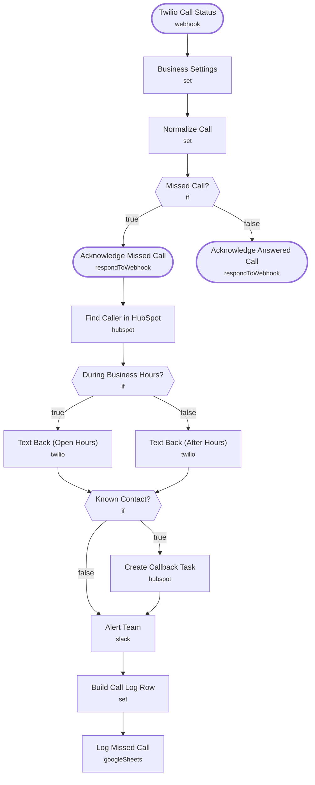

# Missed-Call Text Back

<!-- CANVAS:START -->

<!-- CANVAS:END -->

When a call to your Twilio number goes unanswered, the caller gets a friendly text with your booking link within seconds, worded differently for open hours and after hours. Known HubSpot contacts get a callback task, and the team is alerted in Slack. Text replies are handled by [Missed-Call Reply Classifier](../missed_call_reply_classifier).

Built for offices that miss calls while with clients: CPA firms in tax season, insurance agencies, home-service and real estate teams.

## What it does

1. **Twilio Call Status** (Webhook) receives Twilio's status callback, and **Business Settings** (Set) adds your name, booking link, number, time zone and opening hours.
2. **Normalize Call** (Set) extracts the caller and works out whether the call came in during business hours. **Missed Call?** (If) only lets no-answer, busy, failed and canceled calls continue; **Acknowledge Missed Call** and **Acknowledge Answered Call** always send Twilio an empty TwiML reply.
3. **Find Caller in HubSpot** (HubSpot) searches phone and mobile phone. **During Business Hours?** (If) picks **Text Back (Open Hours)** or **Text Back (After Hours)** (Twilio).
4. **Known Contact?** (If) runs **Create Callback Task** (HubSpot), due in 30 minutes or 9 AM next day after hours.
5. **Alert Team** (Slack) posts to `#missed-calls` either way, then **Build Call Log Row** (Set) and **Log Missed Call** (Google Sheets) record the call.

## Sample request

Twilio sends this automatically. To test by hand:

```bash
curl -X POST https://YOUR-N8N/webhook/missed-call \
  -d "CallSid=CA123" -d "CallStatus=no-answer" -d "From=+16195550142" -d "To=+15555550100"
```

## Setup (about 10 minutes)

1. **Business Settings** — set your business name, booking link, Twilio number, IANA time zone and open/close hours.
2. **Twilio** — connect an account on both **Text Back** nodes, and in the Twilio console set *Call status changes* on your number to the `missed-call` URL.
3. **HubSpot** — connect an account on **Find Caller in HubSpot** and **Create Callback Task**.
4. **Slack** — connect an account on **Alert Team** and point it at your own channel (currently `#missed-calls`).
5. **Google Sheets** — connect an account on **Log Missed Call** and replace the placeholder document ID (`REPLACE_WITH_SPREADSHEET_ID`).
6. **Error handling** — import [Workflow Error Handler](../workflow_error_handler) first, then select it under *Workflow settings → Error workflow* (shipped as `REPLACE_WITH_ERROR_WORKFLOW_ID`).

---

<!-- ARCHITECTURE:START -->
## Architecture



> Shapes: rounded = trigger, hexagon = branch point. Dashed borders mark AI sub-nodes; dotted edges are the model, memory and tool connections feeding an agent. Faded nodes are disabled in this export.
<!-- ARCHITECTURE:END -->
