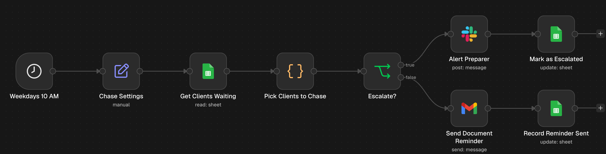
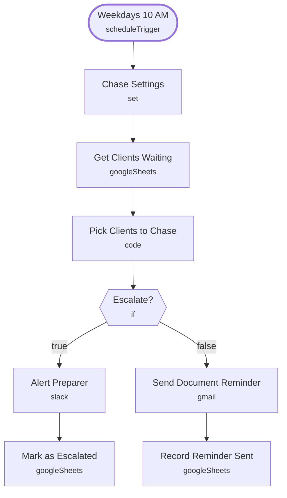

# Missing Document Chaser

<!-- CANVAS:START -->

<!-- CANVAS:END -->

Every weekday it reads the onboarding tracker and emails each client the documents they still owe, with a countdown to the filing deadline and their personal upload link. After three ignored reminders it stops emailing and asks the preparer in Slack to call.

Built for CPA and bookkeeping firms in tax season, where chasing missing W-2s and 1099s eats hours every week. Uses the same tracker as [Client Onboarding Kickoff](../client_onboarding_kickoff).

## What it does

1. **Weekdays 10 AM** (Schedule Trigger) starts the run, and **Chase Settings** (Set) holds the filing deadline, upload link, days between reminders and reminders before escalating.
2. **Get Clients Waiting** (Google Sheets) reads tracker rows with status `waiting`.
3. **Pick Clients to Chase** (Code) skips anyone reminded in the last 3 days, works out days to the deadline and flags clients who have had 3 reminders.
4. **Escalate?** (If) splits two ways:
   - Yes: **Alert Preparer** (Slack) posts to `#tax-season`, then **Mark as Escalated** (Google Sheets) stops further emails.
   - No: **Send Document Reminder** (Gmail) lists the missing documents with the upload link, then **Record Reminder Sent** (Google Sheets) bumps the count and date.

## Sample request

Not applicable — this workflow runs on a weekday schedule and reads from the onboarding tracker rather than an inbound request.

## Setup (about 5 minutes)

1. **Chase Settings** — set your firm name, filing deadline (`YYYY-MM-DD`), upload form URL and reminder rules.
2. **Google Sheets** — connect an account on the three sheet nodes and use the **Onboarding Tracker** sheet (`REPLACE_WITH_SPREADSHEET_ID`).
3. **Gmail** — connect an account on **Send Document Reminder**.
4. **Slack** — connect an account on **Alert Preparer** (currently `#tax-season`).
5. **Error handling** — import [Workflow Error Handler](../workflow_error_handler) first, then select it under *Workflow settings → Error workflow* (shipped as `REPLACE_WITH_ERROR_WORKFLOW_ID`).

---

<!-- ARCHITECTURE:START -->
## Architecture

> Shapes: rounded = trigger, hexagon = branch point. Dashed borders mark AI sub-nodes; dotted edges are the model, memory and tool connections feeding an agent. Faded nodes are disabled in this export.
<!-- ARCHITECTURE:END -->
