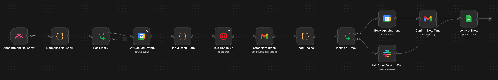
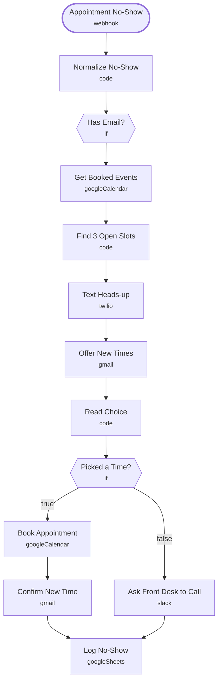

# No-Show Rebooking

<!-- CANVAS:START -->

<!-- CANVAS:END -->

When your booking system marks an appointment as a no-show, this finds three open times in Google Calendar, texts the client a heads-up and emails them a one-click form to pick a new slot. A picked slot is booked straight into the calendar with an invite; anyone who wants a call or doesn't answer goes to the front desk in Slack.

Built for clinics, salons, coaches and any appointment business that loses revenue to missed appointments. Runs after [Appointment Reminder Sender](../appointment_reminder_sender) has done its job.

## What it does

1. **Appointment No-Show** (Webhook) receives the no-show from your booking tool, and **Normalize No-Show** (Code) cleans it up and holds your settings: business name, SMS number, calendar, slot length and opening hours.
2. **Has Email?** (If) stops records without a valid email.
3. **Get Booked Events** (Google Calendar) reads the next few days of bookings, and **Find 3 Open Slots** (Code) picks three free weekday slots inside opening hours.
4. **Text Heads-up** (Twilio) tells the client to check their email.
5. **Offer New Times** (Gmail, send and wait) emails a form with the three times plus "None of these, please call me", and waits up to 3 days.
6. **Read Choice** (Code) reads the answer, and **Picked a Time?** (If) branches:
   - **Book Appointment** (Google Calendar) creates the event and invites the client, then **Confirm New Time** (Gmail) confirms it.
   - **Ask Front Desk to Call** (Slack) posts to `#front-desk` when no time was picked.
7. **Log No-Show** (Google Sheets) records the outcome.

## Sample request

```bash
curl -X POST https://YOUR-N8N/webhook/appointment-no-show \
  -H 'Content-Type: application/json' \
  -d '{"name":"Maria Lopez","email":"maria@example.com","phone":"+15551234567","service":"Dental cleaning","appointmentTime":"2026-12-01T10:00:00"}'
```

## Setup (about 10 minutes)

1. **Booking tool** — send no-shows to the webhook URL from **Appointment No-Show** with the fields shown above.
2. **Normalize No-Show** — set your business name, Twilio number, calendar ID, slot length and opening hours.
3. **Google Calendar** — connect an account on **Get Booked Events** and **Book Appointment**.
4. **Twilio** — connect an account on **Text Heads-up**.
5. **Gmail** — connect an account on **Offer New Times** and **Confirm New Time**.
6. **Slack** — connect an account on **Ask Front Desk to Call** and point it at your own channel (currently `#front-desk`).
7. **Google Sheets** — connect an account on **Log No-Show** and replace the placeholder document ID (`REPLACE_WITH_SPREADSHEET_ID`) with a log sheet.
8. **Error handling** — import [Workflow Error Handler](../workflow_error_handler) first, then select it under *Workflow settings → Error workflow* (shipped as `REPLACE_WITH_ERROR_WORKFLOW_ID`).

---

<!-- ARCHITECTURE:START -->
## Architecture



> Shapes: rounded = trigger, hexagon = branch point. Dashed borders mark AI sub-nodes; dotted edges are the model, memory and tool connections feeding an agent. Faded nodes are disabled in this export.
<!-- ARCHITECTURE:END -->
