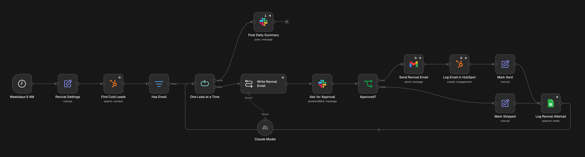
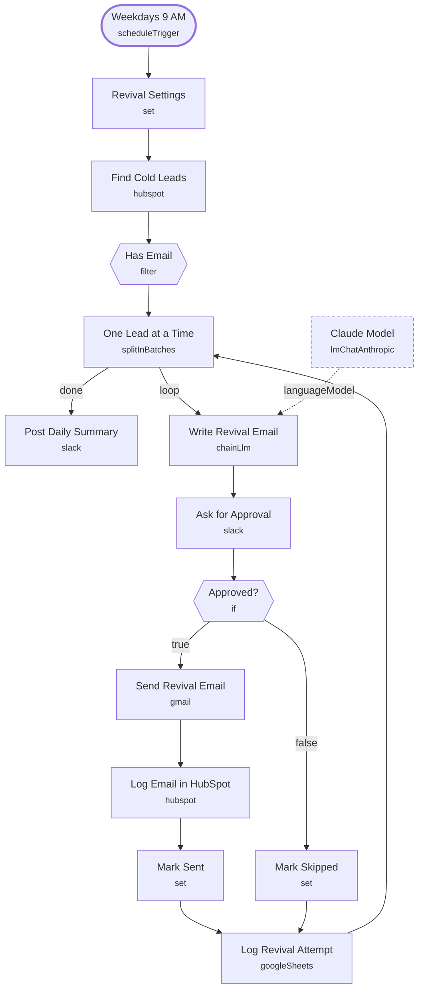

# Old Lead Revival

<!-- CANVAS:START -->

<!-- CANVAS:END -->

Every weekday morning it finds HubSpot leads with no activity for 90+ days, writes each one a short personal check-in with AI, and asks your team to approve every email in Slack before it is sent. Replies are picked up by [Lead Revival Reply Alert](../lead_revival_reply_alert).

Built for firms sitting on a CRM full of leads that went quiet, who want them re-engaged without a blast campaign.

## What it does

1. **Weekdays 9 AM** (Schedule Trigger) starts the run, and **Revival Settings** (Set) holds the sender, booking link, daily cap and cutoff.
2. **Find Cold Leads** (HubSpot) searches for lifecycle = lead, last activity before the cutoff, not opted out, oldest first, up to the daily cap. **Has Email** (Filter) drops anything without an address.
3. **One Lead at a Time** (Loop Over Items) handles each lead:
   - **Write Revival Email** (Basic LLM Chain with **Claude Model**) drafts a 60 to 110 word body from the lead's notes.
   - **Ask for Approval** (Slack) posts it to `#lead-revival` with *Send it* / *Skip* buttons that expire after 24 hours.
   - **Approved?** (If) runs **Send Revival Email** (Gmail, with an opt-out line), **Log Email in HubSpot** (HubSpot) and **Mark Sent**, or **Mark Skipped**. **Log Revival Attempt** (Google Sheets) writes the outcome either way.
4. When the loop finishes, **Post Daily Summary** (Slack) reports how many were sent and skipped.

## Sample request

Not applicable — this workflow runs on a weekday schedule and reads from HubSpot rather than an inbound request.

## Setup (about 15 minutes)

1. **Revival Settings** — set the sender name, booking link and daily cap. Change the 90 in `cutoffMs` to adjust how cold a lead must be.
2. **HubSpot** — connect an account on **Find Cold Leads** and **Log Email in HubSpot**.
3. **Anthropic** — connect an account on **Claude Model**.
4. **Gmail** — connect an account on **Send Revival Email**.
5. **Slack** — connect an account on **Ask for Approval** and **Post Daily Summary** (currently `#lead-revival`). Keep the daily cap small enough for your team to review each morning.
6. **Google Sheets** — connect an account on **Log Revival Attempt** and replace the placeholder document ID (`REPLACE_WITH_SPREADSHEET_ID`).
7. **Error handling** — import [Workflow Error Handler](../workflow_error_handler) first, then select it under *Workflow settings → Error workflow* (shipped as `REPLACE_WITH_ERROR_WORKFLOW_ID`).

---

<!-- ARCHITECTURE:START -->
## Architecture

> Shapes: rounded = trigger, hexagon = branch point. Dashed borders mark AI sub-nodes; dotted edges are the model, memory and tool connections feeding an agent. Faded nodes are disabled in this export.
<!-- ARCHITECTURE:END -->
