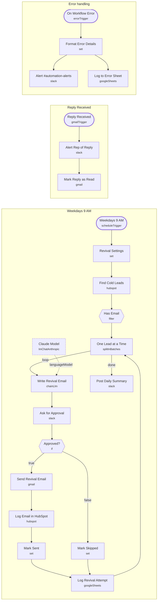

# Old Lead Revival

<!-- CANVAS:START -->

<!-- CANVAS:END -->

Every weekday morning it finds HubSpot leads with no activity for 90+ days, writes each one a short personal check-in with AI, and asks your team to approve every email in Slack before it is sent. Replies alert the rep.

Built for firms sitting on a CRM full of leads that went quiet, who want them re-engaged without a blast campaign.

## What it does

1. **Weekdays 9 AM** starts the run. **Revival Settings** holds the sender, booking link, daily cap and cutoff.
2. **Find Cold Leads** searches HubSpot for lifecycle = lead, last activity before the cutoff, not opted out, oldest first, up to the daily cap. **Has Email** drops anything without an address.
3. **One Lead at a Time** loops: **Write Revival Email** (Claude) drafts a 60 to 110 word body from the lead's notes, then **Ask for Approval** posts it to `#lead-revival` with *Send it* / *Skip* buttons (expires after 24h).
4. Approved: **Send Revival Email** (Gmail, with an opt-out line) and **Log Email in HubSpot**, which also resets the contact's activity date so it is not picked again tomorrow. Either way **Log Revival Attempt** writes the outcome to a sheet.
5. **Post Daily Summary** reports how many were sent and skipped.
6. **Reply Received** polls Gmail every 15 minutes for replies, **Alert Rep of Reply** posts them, and **Mark Reply as Read** stops double alerts.
7. **On Workflow Error** posts any failure to `#automation-alerts` and logs it.

## Sample request

Not applicable: runs on a weekday schedule and reads from HubSpot.

## Setup

1. **Revival Settings**: sender name, booking link, daily cap. Change the 90 in `cutoffMs` to adjust how cold a lead must be.
2. Connect **HubSpot**, **Anthropic**, **Slack**, **Gmail** and **Google Sheets**.
3. Create `#lead-revival` and `#automation-alerts` in Slack.
4. Approvals run one at a time, so keep the daily cap small enough for your team to review each morning.

Every workflow ships inactive with credential placeholders. Connect your own accounts, run one test, then activate.

---

<!-- ARCHITECTURE:START -->
## Architecture

> Shapes: rounded = trigger, hexagon = branch point. Dashed borders mark AI sub-nodes; dotted edges are the model, memory and tool connections feeding an agent. Faded nodes are disabled in this export.
<!-- ARCHITECTURE:END -->
