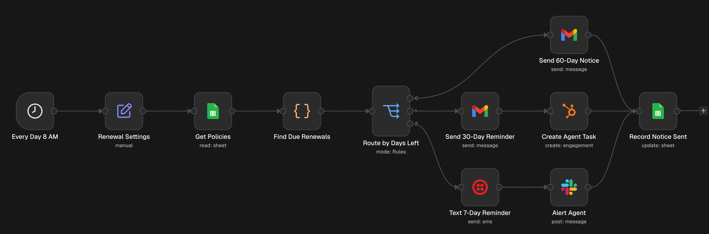
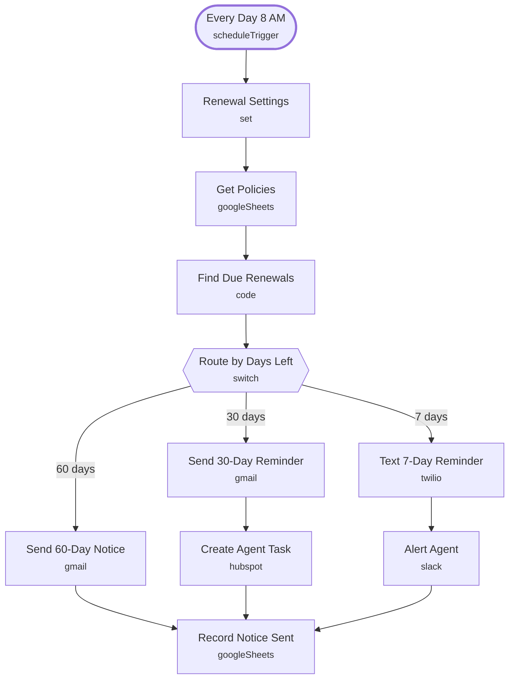

# Policy Renewal Chaser

<!-- CANVAS:START -->

<!-- CANVAS:END -->

Every morning it checks your renewal list and contacts clients 60, 30 and 7 days before each policy renews: an early review email, a reminder with an agent task in HubSpot, and a final text message with a Slack alert. Each notice is sent once.

Built for independent insurance agencies that lose clients when renewals slip by unnoticed.

## What it does

1. **Every Day 8 AM** (Schedule Trigger) starts the run, and **Renewal Settings** (Set) holds your agency name, phone, booking link and SMS number.
2. **Get Policies** (Google Sheets) reads the renewal list.
3. **Find Due Renewals** (Code) keeps policies exactly 60, 30 or 7 days from renewal that are not marked renewed and have not had that notice yet.
4. **Route by Days Left** (Switch) sends each policy down one of three paths:
   - 60 days: **Send 60-Day Notice** (Gmail) invites a coverage review.
   - 30 days: **Send 30-Day Reminder** (Gmail) and **Create Agent Task** (HubSpot).
   - 7 days: **Text 7-Day Reminder** (Twilio) and **Alert Agent** (Slack) to `#renewals`.
5. **Record Notice Sent** (Google Sheets) writes the stage to `lastNotice` so nothing is sent twice.

## Sample request

Not applicable — this workflow runs on a daily schedule and reads from a Google Sheet rather than an inbound request.

## Setup (about 10 minutes)

1. **Google Sheets** — create a renewal sheet with headers `policyNumber, clientName, email, phone, policyType, carrier, premium, renewalDate, agent, status, lastNotice` (`renewalDate` as `YYYY-MM-DD`, `status` = `renewed` once done). Connect an account on **Get Policies** and **Record Notice Sent**, and replace the placeholder document ID (`REPLACE_WITH_SPREADSHEET_ID`).
2. **Renewal Settings** — set your agency name, phone, booking link and Twilio number.
3. **Gmail** — connect an account on both email nodes.
4. **HubSpot** — connect an account on **Create Agent Task**.
5. **Twilio** — connect an account on **Text 7-Day Reminder**; the number must be SMS-enabled.
6. **Slack** — connect an account on **Alert Agent** (currently `#renewals`).
7. **Error handling** — import [Workflow Error Handler](../workflow_error_handler) first, then select it under *Workflow settings → Error workflow* (shipped as `REPLACE_WITH_ERROR_WORKFLOW_ID`).

---

<!-- ARCHITECTURE:START -->
## Architecture

> Shapes: rounded = trigger, hexagon = branch point. Dashed borders mark AI sub-nodes; dotted edges are the model, memory and tool connections feeding an agent. Faded nodes are disabled in this export.
<!-- ARCHITECTURE:END -->
