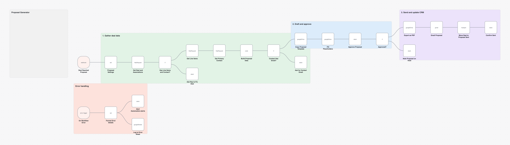
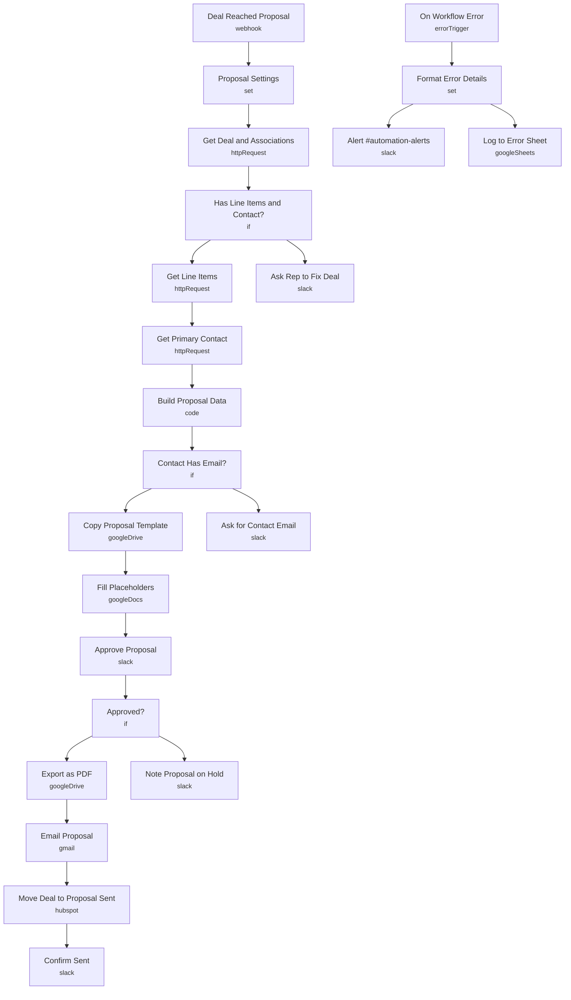

# Proposal Generator (HubSpot + Google Docs)

<!-- CANVAS:START -->

<!-- CANVAS:END -->

When a HubSpot deal reaches your proposal stage, this pulls the deal, its line items and the main contact, fills a Google Docs template and posts the draft to Slack. After approval it emails the client a PDF and moves the deal to the next stage.

Built for agencies, consultancies and accounting firms that rebuild the same proposal by hand for every deal.

## What it does

1. **Deal Reached Proposal** receives `dealId` from a HubSpot workflow webhook. **Proposal Settings** holds the template, output folder, sender and next stage ID.
2. **Get Deal and Associations** calls the HubSpot API. **Has Line Items and Contact?** sends incomplete deals back to the rep via **Ask Rep to Fix Deal** instead of failing.
3. **Get Line Items** and **Get Primary Contact** fetch the details. **Build Proposal Data** (Code) formats the line items, total, dates and file name. **Contact Has Email?** guards the send.
4. **Copy Proposal Template** and **Fill Placeholders** create the client's document. **Approve Proposal** posts a link to the draft in `#proposals` and waits up to 3 days.
5. Approved: **Export as PDF**, **Email Proposal** with the PDF attached, **Move Deal to Proposal Sent**, **Confirm Sent**. On hold: **Note Proposal on Hold** keeps the draft for manual sending.
6. **On Workflow Error** posts any failure to `#automation-alerts` and logs it.

## Sample request

```bash
curl -X POST https://YOUR-N8N/webhook/proposal-ready \
  -H "Content-Type: application/json" -d '{"dealId":"4401"}'
```

Template placeholders: `{{client_name}}`, `{{client_company}}`, `{{deal_name}}`, `{{scope}}`, `{{line_items}}`, `{{total}}`, `{{proposal_date}}`, `{{valid_until}}`.

## Setup

1. Create a Google Docs template with the placeholders above and a folder for finished proposals. Put both IDs in **Proposal Settings**.
2. Set `sentStageId` to your pipeline's next stage ID and `hubspotPortalId` to your portal.
3. In a HubSpot workflow (deal enters proposal stage), add *Send a webhook* with `dealId` to the `/proposal-ready` URL.
4. Connect **HubSpot** (also on the three HTTP Request nodes), **Google Drive**, **Google Docs**, **Gmail** and **Slack**.

Every workflow ships inactive with credential placeholders. Connect your own accounts, run one test, then activate.

---

<!-- ARCHITECTURE:START -->
## Architecture


<!-- ARCHITECTURE:END -->
