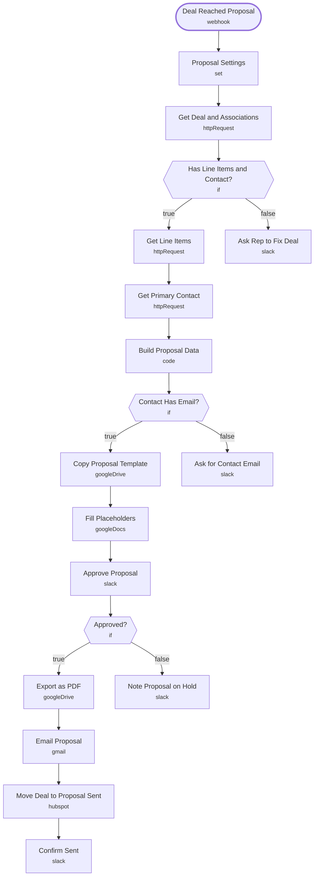

# Proposal Generator (HubSpot + Google Docs)

<!-- CANVAS:START -->

<!-- CANVAS:END -->

When a HubSpot deal reaches your proposal stage, this pulls the deal, its line items and the main contact, fills a Google Docs template and posts the draft to Slack. After approval it emails the client a PDF and moves the deal to the next stage.

Built for agencies, consultancies and accounting firms that rebuild the same proposal by hand for every deal.

## What it does

1. **Deal Reached Proposal** (Webhook) receives `dealId` from a HubSpot workflow, and **Proposal Settings** (Set) holds the template, output folder, sender and next stage ID.
2. **Get Deal and Associations** (HTTP Request) calls the HubSpot API. **Has Line Items and Contact?** (If) sends incomplete deals to **Ask Rep to Fix Deal** (Slack) instead of failing.
3. **Get Line Items** and **Get Primary Contact** (HTTP Request) fetch the details, and **Build Proposal Data** (Code) formats the line items, total, dates and file name. **Contact Has Email?** (If) sends missing emails to **Ask for Contact Email** (Slack).
4. **Copy Proposal Template** (Google Drive) and **Fill Placeholders** (Google Docs) create the client's document. **Approve Proposal** (Slack) posts the draft link to `#proposals` and waits up to 3 days.
5. **Approved?** (If) splits two ways:
   - Approved: **Export as PDF** (Google Drive), **Email Proposal** (Gmail) with the PDF attached, **Move Deal to Proposal Sent** (HubSpot) and **Confirm Sent** (Slack).
   - On hold: **Note Proposal on Hold** (Slack) keeps the draft for manual sending.

## Sample request

```bash
curl -X POST https://YOUR-N8N/webhook/proposal-ready \
  -H "Content-Type: application/json" -d '{"dealId":"4401"}'
```

Template placeholders: `{{client_name}}`, `{{client_company}}`, `{{deal_name}}`, `{{scope}}`, `{{line_items}}`, `{{total}}`, `{{proposal_date}}`, `{{valid_until}}`.

## Setup (about 20 minutes)

1. **Google Docs template** — create a template with the placeholders above and a folder for finished proposals, then put both IDs in **Proposal Settings**.
2. **Proposal Settings** — set `sentStageId` to your pipeline's next stage ID and `hubspotPortalId` to your portal.
3. **HubSpot** — connect an account on **Move Deal to Proposal Sent** and the three HTTP Request nodes. In a HubSpot workflow (deal enters proposal stage), add *Send a webhook* with `dealId` to the `/proposal-ready` URL.
4. **Google Drive** and **Google Docs** — connect accounts on **Copy Proposal Template**, **Export as PDF** and **Fill Placeholders**.
5. **Gmail** — connect an account on **Email Proposal**.
6. **Slack** — connect an account on the Slack nodes and point them at your own channel (currently `#proposals`).
7. **Error handling** — import [Workflow Error Handler](../workflow_error_handler) first, then select it under *Workflow settings → Error workflow* (shipped as `REPLACE_WITH_ERROR_WORKFLOW_ID`).

---

<!-- ARCHITECTURE:START -->
## Architecture



> Shapes: rounded = trigger, hexagon = branch point. Dashed borders mark AI sub-nodes; dotted edges are the model, memory and tool connections feeding an agent. Faded nodes are disabled in this export.
<!-- ARCHITECTURE:END -->
