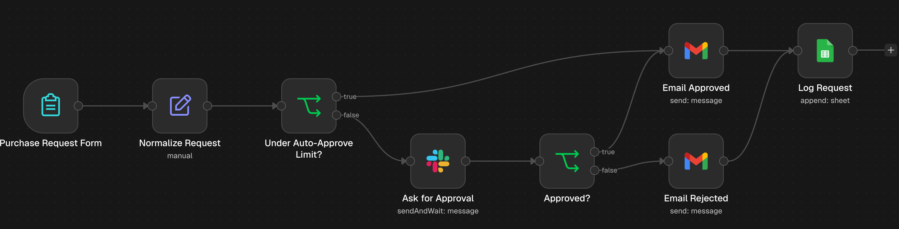
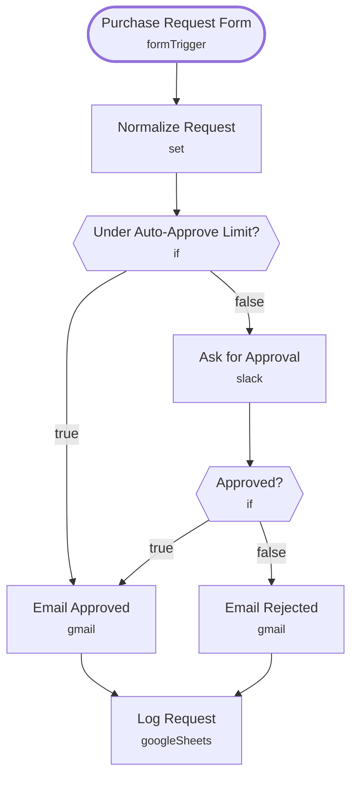

# Purchase & Expense Approval in Slack

<!-- CANVAS:START -->

<!-- CANVAS:END -->

Staff fill in a short purchase request form. Requests under your limit are approved straight away; anything above it goes to Slack with Approve and Reject buttons. The requester gets the decision by email and every request is logged.

Built for growing teams that need spend control without buying an approvals tool.

## What it does

1. **Purchase Request Form** (Form Trigger) collects name, email, item, vendor, amount, category and reason.
2. **Normalize Request** (Set) cleans the answers, adds a request ID and holds the auto-approve limit (default $100).
3. **Under Auto-Approve Limit?** (If) approves small requests at once and sends the rest to **Ask for Approval** (Slack, send and wait), which posts to `#approvals` and waits up to 3 days.
4. **Approved?** (If) routes the answer:
   - **Email Approved** (Gmail) tells the requester to go ahead.
   - **Email Rejected** (Gmail) tells them it was not approved (or nobody answered in time).
5. **Log Request** (Google Sheets) records the request and whether it was auto-approved, approved or rejected.

## Sample request

Not applicable — requests come in through the hosted n8n form at `/form/purchase-request`.

## Setup (about 10 minutes)

1. **Normalize Request** — set the auto-approve limit.
2. **Slack** — connect an account on **Ask for Approval** and point it at your own channel (currently `#approvals`).
3. **Gmail** — connect an account on **Email Approved** and **Email Rejected**.
4. **Google Sheets** — connect an account on **Log Request** and replace the placeholder document ID (`REPLACE_WITH_SPREADSHEET_ID`) with a log sheet. Use it for month-end entry into your accounting tool.
5. **Form** — activate the workflow and share the form URL from **Purchase Request Form** with your team.
6. **Error handling** — import [Workflow Error Handler](../workflow_error_handler) first, then select it under *Workflow settings → Error workflow* (shipped as `REPLACE_WITH_ERROR_WORKFLOW_ID`).

---

<!-- ARCHITECTURE:START -->
## Architecture

> Shapes: rounded = trigger, hexagon = branch point. Dashed borders mark AI sub-nodes; dotted edges are the model, memory and tool connections feeding an agent. Faded nodes are disabled in this export.
<!-- ARCHITECTURE:END -->
