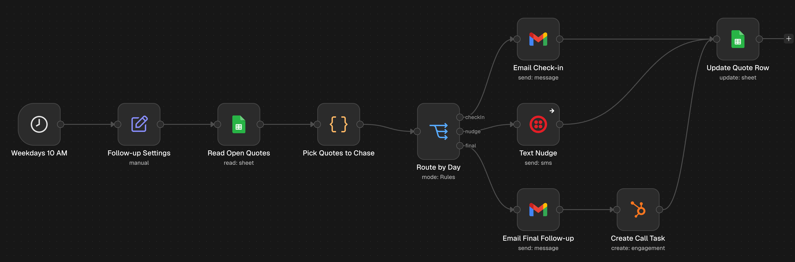
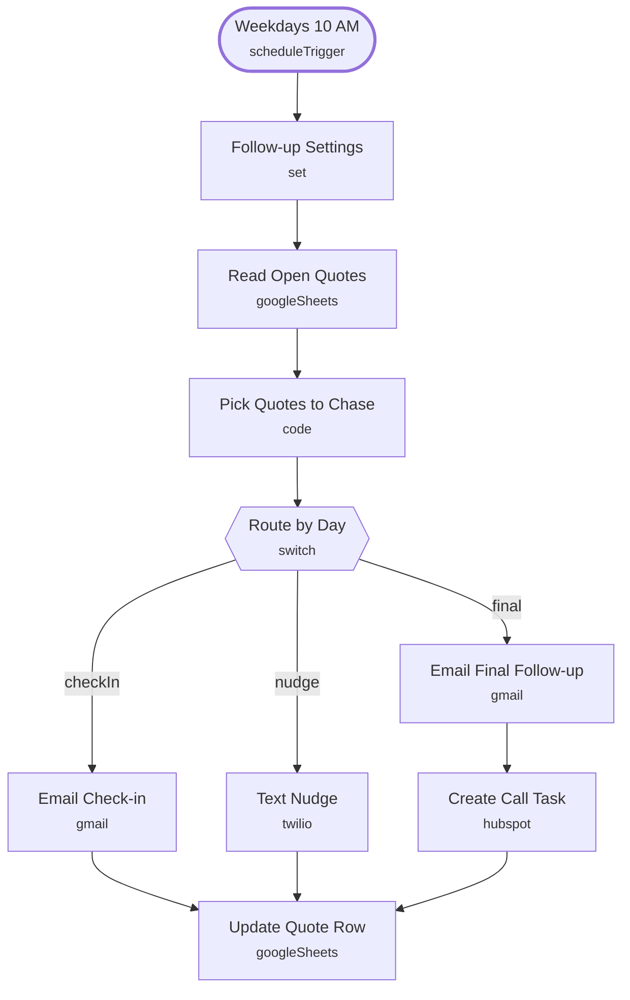

# Quote Follow-up Chaser

<!-- CANVAS:START -->

<!-- CANVAS:END -->

Every weekday it finds quotes that were sent but never answered and follows up on day 2 by email, day 5 by text and day 10 with a final email plus a call task in HubSpot. Each follow-up goes out once, and the quote row records what was sent.

Built for contractors, agencies and home service businesses that send quotes and then forget to chase them. Pairs with [Estimate Request to AI Quote](../estimate_request_ai_quote).

## What it does

1. **Weekdays 10 AM** (Schedule Trigger) starts the run, and **Follow-up Settings** (Set) holds your business name, sender name and SMS number.
2. **Read Open Quotes** (Google Sheets) reads every quote whose `status` is `sent`. Change the status to `accepted`, `declined` or `replied` and the quote drops out.
3. **Pick Quotes to Chase** (Code) keeps quotes sent exactly 2, 5 or 10 days ago that have not had that follow-up yet.
4. **Route by Day** (Switch) picks the follow-up:
   - **Email Check-in** (Gmail) on day 2.
   - **Text Nudge** (Twilio) on day 5.
   - **Email Final Follow-up** (Gmail) on day 10, then **Create Call Task** (HubSpot) so someone phones them.
5. **Update Quote Row** (Google Sheets) saves which follow-ups were sent and when.

## Sample request

Not applicable — this workflow runs on a schedule and reads from a Google Sheet of sent quotes rather than an inbound request.

## Setup (about 10 minutes)

1. **Google Sheets** — connect an account on **Read Open Quotes** and **Update Quote Row**, and replace the placeholder document ID (`REPLACE_WITH_SPREADSHEET_ID`) with a sheet with the columns `quoteNumber`, `name`, `email`, `phone`, `amount`, `quoteLink`, `sentDate`, `status`, `lastFollowUp`, `lastFollowUpDate`.
2. **Follow-up Settings** — set your business name, sender name and Twilio number.
3. **Gmail** — connect an account on **Email Check-in** and **Email Final Follow-up**.
4. **Twilio** — connect an account on **Text Nudge**. Quotes without a phone number skip the text and carry on.
5. **HubSpot** — connect an account on **Create Call Task**.
6. **Error handling** — import [Workflow Error Handler](../workflow_error_handler) first, then select it under *Workflow settings → Error workflow* (shipped as `REPLACE_WITH_ERROR_WORKFLOW_ID`).

---

<!-- ARCHITECTURE:START -->
## Architecture

> Shapes: rounded = trigger, hexagon = branch point. Dashed borders mark AI sub-nodes; dotted edges are the model, memory and tool connections feeding an agent. Faded nodes are disabled in this export.
<!-- ARCHITECTURE:END -->
