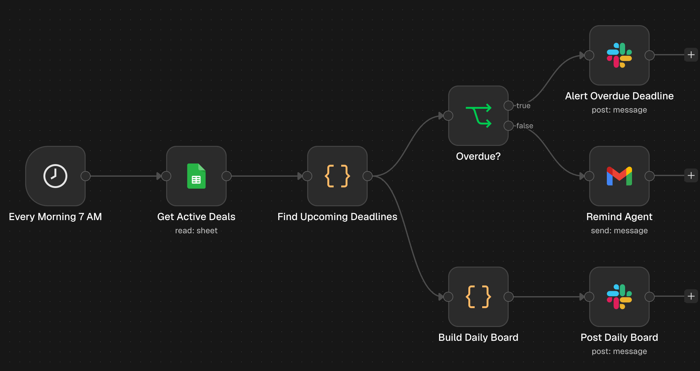
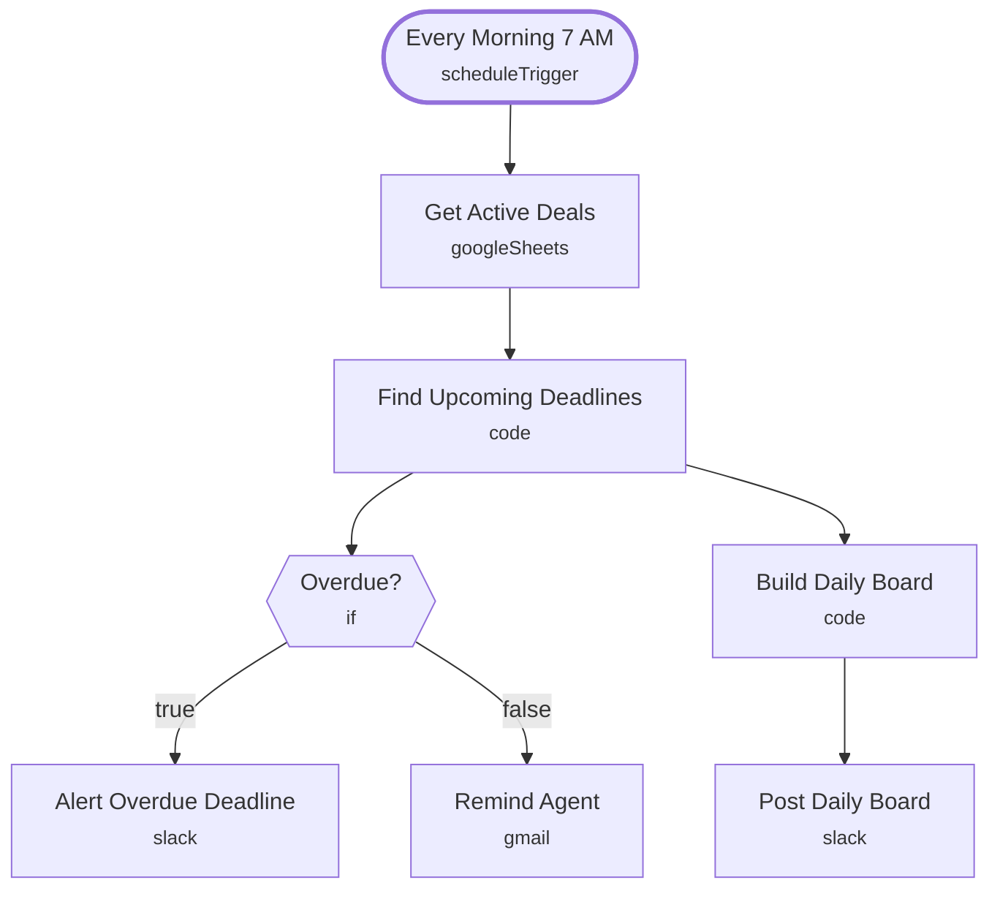

# Real Estate Deal Deadline Tracker

<!-- CANVAS:START -->

<!-- CANVAS:END -->

Every morning it scans active deals for contract deadlines in the next 3 days: earnest money, inspection, appraisal, financing, walk-through and closing. Agents get an email for each upcoming deadline, overdue ones are flagged in Slack, and the team gets one daily board.

Built for real estate teams, transaction coordinators and escrow offices juggling dozens of deals, where one missed contingency date can kill a sale.

## What it does

1. **Every Morning 7 AM** (Schedule Trigger) starts the run.
2. **Get Active Deals** (Google Sheets) reads deals with status `active`.
3. **Find Upcoming Deadlines** (Code) makes one item per milestone due within 3 days or overdue, skipping any marked done.
4. From there the flow splits two ways:
   - **Overdue?** (If) sends overdue deadlines to **Alert Overdue Deadline** (Slack) and upcoming ones to **Remind Agent** (Gmail).
   - **Build Daily Board** (Code) and **Post Daily Board** (Slack) post one sorted list to `#transactions`.

## Sample request

Not applicable — this workflow runs on a daily schedule and reads from a Google Sheet rather than an inbound request.

## Setup (about 10 minutes)

1. **Google Sheets** — create a deal sheet with headers `address, client, agentName, agentEmail, status, earnestMoneyDue, inspectionDeadline, appraisalDeadline, financingDeadline, finalWalkthrough, closingDate` plus a `...Done` column for each date (e.g. `inspectionDeadlineDone` = `yes`). Dates as `YYYY-MM-DD`. Connect an account on **Get Active Deals** and replace the placeholder document ID (`REPLACE_WITH_SPREADSHEET_ID`).
2. **Gmail** — connect an account on **Remind Agent**.
3. **Slack** — connect an account on both Slack nodes (currently `#transactions`).
4. **Find Upcoming Deadlines** — change `WARN_DAYS` if you want more notice.
5. **Error handling** — import [Workflow Error Handler](../workflow_error_handler) first, then select it under *Workflow settings → Error workflow* (shipped as `REPLACE_WITH_ERROR_WORKFLOW_ID`).

---

<!-- ARCHITECTURE:START -->
## Architecture

> Shapes: rounded = trigger, hexagon = branch point. Dashed borders mark AI sub-nodes; dotted edges are the model, memory and tool connections feeding an agent. Faded nodes are disabled in this export.
<!-- ARCHITECTURE:END -->
