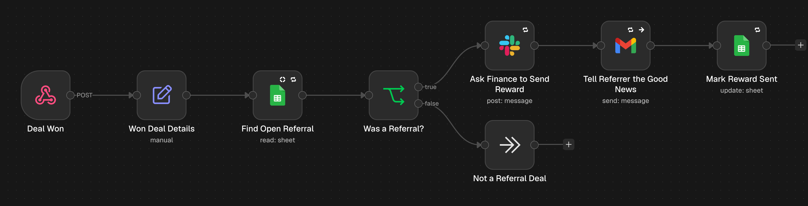
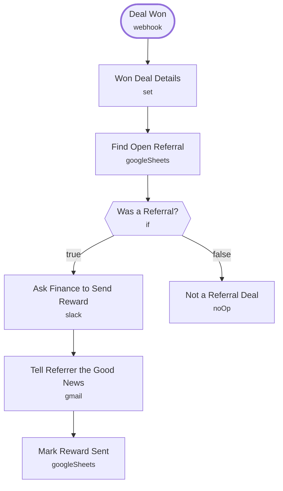

# Referral Reward on Deal Won

<!-- CANVAS:START -->

<!-- CANVAS:END -->

When a referred lead becomes a client, it asks finance to send the referrer's reward, emails the referrer the good news and marks the referral rewarded. Nobody is rewarded twice.

The second half of [Referral Tracking & Rewards](../referral_tracking_rewards), for referral-driven firms that log referrals in a sheet.

## What it does

1. **Deal Won** (Webhook) receives the client's email from a HubSpot workflow, and **Won Deal Details** (Set) adds the reward text.
2. **Find Open Referral** (Google Sheets) looks for a tracker row still marked `referred`.
3. **Was a Referral?** (If) splits two ways:
   - Yes: **Ask Finance to Send Reward** (Slack), **Tell Referrer the Good News** (Gmail) and **Mark Reward Sent** (Google Sheets), which changes the status so the reward cannot fire twice.
   - No: **Not a Referral Deal** ends the run.

## Sample request

```bash
curl -X POST https://YOUR-N8N/webhook/referral-deal-won \
  -H "Content-Type: application/json" \
  -d '{"contactEmail":"marcus@leewealth.com","dealName":"Lee Wealth - Onboarding automation","amount":"9000"}'
```

## Setup (about 10 minutes)

1. **HubSpot** — in a HubSpot workflow (deal closed won), send the primary contact's email to `/referral-deal-won`.
2. **Google Sheets** — connect an account on **Find Open Referral** and **Mark Reward Sent**, and use the same **Referral Tracker** sheet (`REPLACE_WITH_SPREADSHEET_ID`).
3. **Gmail** — connect an account on **Tell Referrer the Good News**.
4. **Slack** — connect an account on **Ask Finance to Send Reward**.
5. **Won Deal Details** — edit the reward text.
6. **Error handling** — import [Workflow Error Handler](../workflow_error_handler) first, then select it under *Workflow settings → Error workflow* (shipped as `REPLACE_WITH_ERROR_WORKFLOW_ID`).

---

<!-- ARCHITECTURE:START -->
## Architecture



> Shapes: rounded = trigger, hexagon = branch point. Dashed borders mark AI sub-nodes; dotted edges are the model, memory and tool connections feeding an agent. Faded nodes are disabled in this export.
<!-- ARCHITECTURE:END -->
