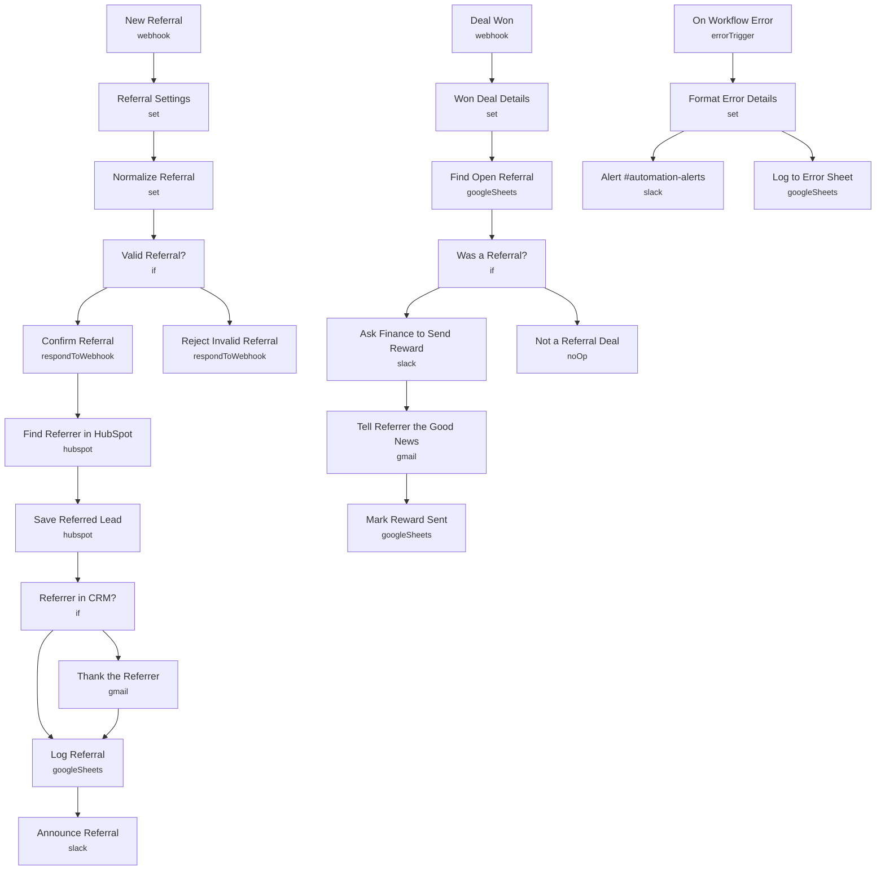

# Referral Tracking & Rewards

<!-- CANVAS:START -->

<!-- CANVAS:END -->

Captures referrals, thanks the referrer, logs everything in a tracker sheet, and when the referred lead becomes a client it asks finance to send the reward and tells the referrer the good news. Nobody is rewarded twice.

Built for referral-driven firms (CPAs, advisors, agencies, contractors) that track referrals in someone's head or an inbox.

## What it does

1. **New Referral** receives the form. **Referral Settings** holds the sender and reward text. **Normalize Referral** cleans both emails.
2. **Valid Referral?** requires both emails and blocks self-referrals (400 otherwise). **Confirm Referral** answers the form.
3. **Find Referrer in HubSpot** looks up the referrer. **Save Referred Lead** upserts the new lead with `referred_by_email`.
4. **Referrer in CRM?** decides whether **Thank the Referrer** emails them. **Log Referral** writes the row (status `referred`) and **Announce Referral** posts to `#referrals`.
5. **Deal Won** receives the client's email from a HubSpot workflow. **Find Open Referral** looks for a row still marked `referred`.
6. **Was a Referral?** runs **Ask Finance to Send Reward**, **Tell Referrer the Good News** and **Mark Reward Sent**, which changes the status so the reward cannot fire again.
7. **On Workflow Error** posts any failure to `#automation-alerts` and logs it.

## Sample request

```bash
curl -X POST https://YOUR-N8N/webhook/referral \
  -H "Content-Type: application/json" \
  -d '{"firstName":"Marcus","lastName":"Lee","email":"marcus@leewealth.com","company":"Lee Wealth Partners","referredByEmail":"dana@whitfieldcpa.com","note":"Dana said you fixed their intake process"}'

curl -X POST https://YOUR-N8N/webhook/referral-deal-won \
  -H "Content-Type: application/json" \
  -d '{"contactEmail":"marcus@leewealth.com","dealName":"Lee Wealth - Onboarding automation","amount":"9000"}'
```

## Setup

1. In HubSpot, create a contact property `referred_by_email` (single-line text).
2. Create a **Referral Tracker** sheet with headers: `receivedAt, leadEmail, leadName, leadCompany, referrerEmail, referrerName, referrerInCrm, status, rewardedAt`.
3. In a HubSpot workflow (deal closed won), send the primary contact's email to `/referral-deal-won`.
4. Edit the reward text in **Referral Settings** and **Won Deal Details**, then connect **HubSpot**, **Gmail**, **Slack** and **Google Sheets**.

Every workflow ships inactive with credential placeholders. Connect your own accounts, run one test, then activate.

---

<!-- ARCHITECTURE:START -->
## Architecture


<!-- ARCHITECTURE:END -->
