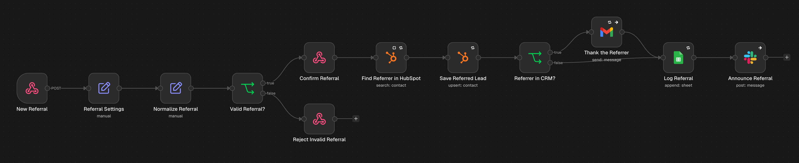
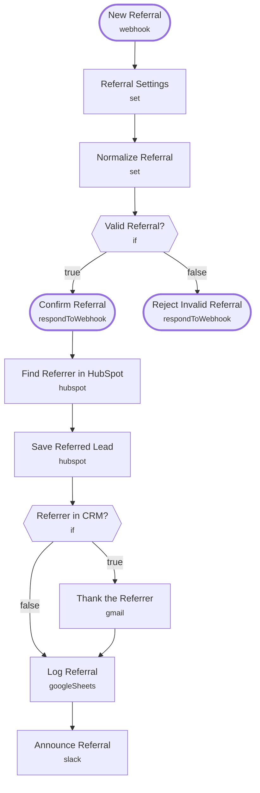

# Referral Tracking & Rewards

<!-- CANVAS:START -->

<!-- CANVAS:END -->

Captures referrals, thanks the referrer, logs everything in a tracker sheet and announces it in Slack. When the referred lead becomes a client, [Referral Reward on Deal Won](../referral_reward_on_deal_won) handles the reward.

Built for referral-driven firms (CPAs, advisors, agencies, contractors) that track referrals in someone's head or an inbox.

## What it does

1. **New Referral** (Webhook) receives the form, **Referral Settings** (Set) holds the sender and reward text and **Normalize Referral** (Set) cleans both emails.
2. **Valid Referral?** (If) requires both emails and blocks self-referrals, sending bad ones to **Reject Invalid Referral** (400). **Confirm Referral** (Respond to Webhook) answers the form.
3. **Find Referrer in HubSpot** (HubSpot) looks up the referrer and **Save Referred Lead** (HubSpot) upserts the new lead with `referred_by_email`.
4. **Referrer in CRM?** (If) decides whether **Thank the Referrer** (Gmail) emails them.
5. **Log Referral** (Google Sheets) writes the row with status `referred` and **Announce Referral** (Slack) posts to `#referrals`.

## Sample request

```bash
curl -X POST https://YOUR-N8N/webhook/referral \
  -H "Content-Type: application/json" \
  -d '{"firstName":"Marcus","lastName":"Lee","email":"marcus@leewealth.com","company":"Lee Wealth Partners","referredByEmail":"dana@whitfieldcpa.com","note":"Dana said you fixed their intake process"}'
```

## Setup (about 10 minutes)

1. **HubSpot** — create a contact property `referred_by_email` (single-line text), then connect an account on **Find Referrer in HubSpot** and **Save Referred Lead**.
2. **Google Sheets** — create a **Referral Tracker** sheet with headers `receivedAt, leadEmail, leadName, leadCompany, referrerEmail, referrerName, referrerInCrm, status, rewardedAt`, connect an account on **Log Referral** and replace the placeholder document ID (`REPLACE_WITH_SPREADSHEET_ID`).
3. **Gmail** — connect an account on **Thank the Referrer**.
4. **Slack** — connect an account on **Announce Referral** (currently `#referrals`).
5. **Referral Settings** — edit the sender and reward text.
6. **Error handling** — import [Workflow Error Handler](../workflow_error_handler) first, then select it under *Workflow settings → Error workflow* (shipped as `REPLACE_WITH_ERROR_WORKFLOW_ID`).

---

<!-- ARCHITECTURE:START -->
## Architecture



> Shapes: rounded = trigger, hexagon = branch point. Dashed borders mark AI sub-nodes; dotted edges are the model, memory and tool connections feeding an agent. Faded nodes are disabled in this export.
<!-- ARCHITECTURE:END -->
