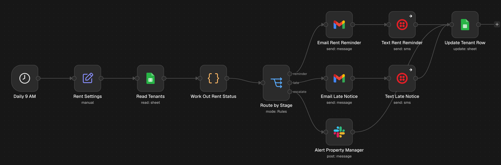
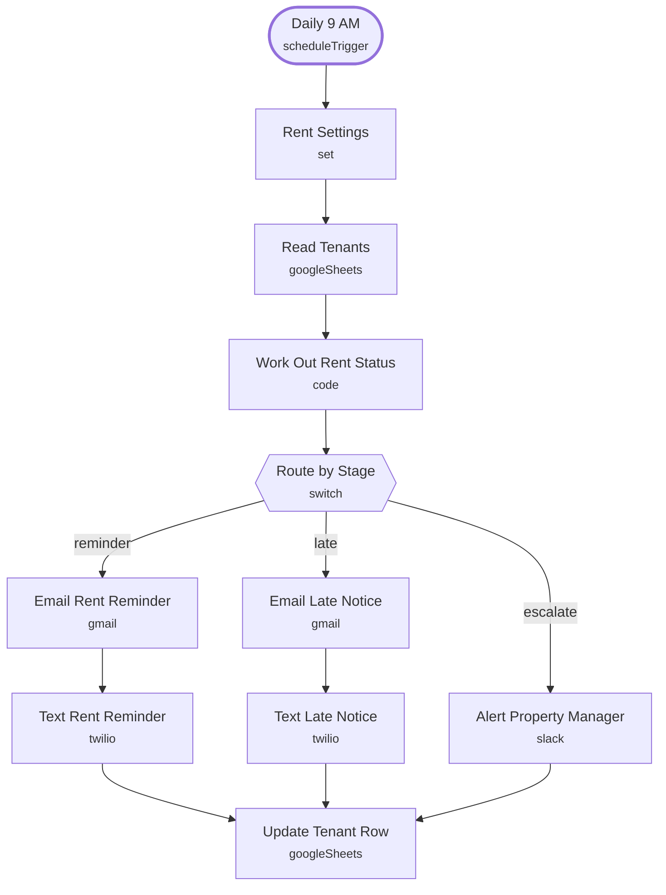

# Rent Reminder & Late Notice

<!-- CANVAS:START -->

<!-- CANVAS:END -->

Every morning it checks which tenants have not paid this month's rent. Tenants get an email and a text 3 days before rent is due and a late notice with the late fee the day after; on day 5 the property manager is alerted in Slack. Each notice is saved on the tenant's row.

Built for small landlords and property managers who track rent in a spreadsheet and chase it by hand.

## What it does

1. **Daily 9 AM** (Schedule Trigger) starts the run, and **Rent Settings** (Set) holds the due day, late fee, payment link and SMS number.
2. **Read Tenants** (Google Sheets) reads every tenant.
3. **Work Out Rent Status** (Code) skips tenants whose `paidMonth` is this month, then decides who needs a reminder, a late notice or an escalation today.
4. **Route by Stage** (Switch) sends each tenant down one path:
   - **Email Rent Reminder** (Gmail), then **Text Rent Reminder** (Twilio).
   - **Email Late Notice** (Gmail), then **Text Late Notice** (Twilio), both with the fee added.
   - **Alert Property Manager** (Slack) posts to `#rent-collection`.
5. **Update Tenant Row** (Google Sheets) saves the notice and any late fee due.

## Sample request

Not applicable — this workflow runs on a schedule and reads from a Google Sheet of tenants rather than an inbound request.

## Setup (about 10 minutes)

1. **Google Sheets** — connect an account on **Read Tenants** and **Update Tenant Row**, and replace the placeholder document ID (`REPLACE_WITH_SPREADSHEET_ID`) with a sheet with the columns `tenantName`, `unit`, `email`, `phone`, `rent`, `paidMonth`, `lastNotice`, `lateFeeDue`. Mark a payment by typing the month (e.g. `2026-12`) into `paidMonth`.
2. **Rent Settings** — set the rent due day, late fee, payment link and Twilio number. Check the fee and timing against your lease and local law.
3. **Gmail** — connect an account on the two email nodes.
4. **Twilio** — connect an account on the two text nodes.
5. **Slack** — connect an account on **Alert Property Manager** and point it at your own channel (currently `#rent-collection`).
6. **Error handling** — import [Workflow Error Handler](../workflow_error_handler) first, then select it under *Workflow settings → Error workflow* (shipped as `REPLACE_WITH_ERROR_WORKFLOW_ID`).

---

<!-- ARCHITECTURE:START -->
## Architecture

> Shapes: rounded = trigger, hexagon = branch point. Dashed borders mark AI sub-nodes; dotted edges are the model, memory and tool connections feeding an agent. Faded nodes are disabled in this export.
<!-- ARCHITECTURE:END -->
