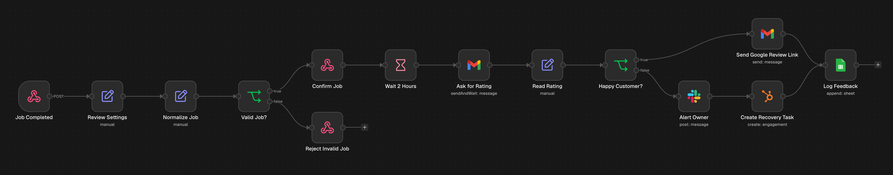
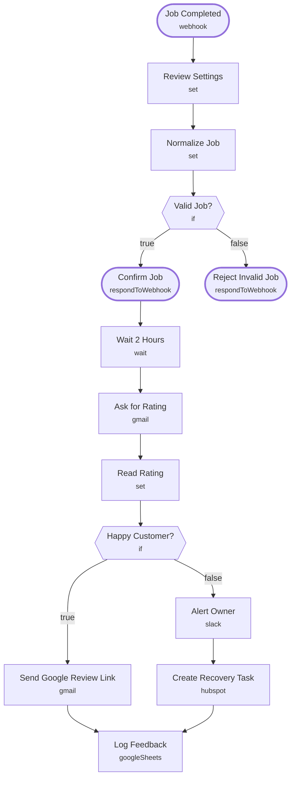

# Review Request After a Job

<!-- CANVAS:START -->

<!-- CANVAS:END -->

When a job is marked complete, it waits two hours, then emails the customer a one-question rating form. Happy customers (4 or 5 stars) get your Google review link; unhappy ones go straight to the owner in Slack with a recovery task in HubSpot, before they post a bad review.

Built for local service businesses (home services, clinics, salons, contractors) that live on Google reviews.

## What it does

1. **Job Completed** (Webhook) receives the finished job from your job or CRM tool, and **Review Settings** (Set) holds your business name and Google review link.
2. **Normalize Job** (Set) cleans the customer's name and email. **Valid Job?** (If) sends bad emails to **Reject Invalid Job**, which answers with a 400.
3. **Confirm Job** (Respond to Webhook) answers right away, then **Wait 2 Hours** (Wait) gives the customer time to settle in.
4. **Ask for Rating** (Gmail) emails a short form (1 to 5 stars plus a comment) and waits up to 7 days for the answer. **Read Rating** (Set) pulls out the score.
5. **Happy Customer?** (If) splits two ways:
   - 4 or 5 stars: **Send Google Review Link** (Gmail) asks them to share it publicly.
   - 3 or lower: **Alert Owner** (Slack) posts the feedback to `#customer-feedback` and **Create Recovery Task** (HubSpot) adds a call-back task.
6. **Log Feedback** (Google Sheets) records every rating and comment.

## Sample request

```bash
curl -X POST https://YOUR-N8N/webhook/job-completed \
  -H "Content-Type: application/json" \
  -d '{"jobId":"J-1042","firstName":"Maria","email":"maria@example.com","jobType":"AC tune-up"}'
```

## Setup (about 10 minutes)

1. **Review Settings** — set your business name, sender name and Google review link (*Get more reviews* in your Google Business Profile).
2. **Job tool** — send a webhook to `/job-completed` when a job closes.
3. **Gmail** — connect an account on **Ask for Rating** and **Send Google Review Link**.
4. **Slack** — connect an account on **Alert Owner** (currently `#customer-feedback`).
5. **HubSpot** — connect an account on **Create Recovery Task**.
6. **Google Sheets** — connect an account on **Log Feedback** and replace the placeholder document ID (`REPLACE_WITH_SPREADSHEET_ID`).
7. **Error handling** — import [Workflow Error Handler](../workflow_error_handler) first, then select it under *Workflow settings → Error workflow* (shipped as `REPLACE_WITH_ERROR_WORKFLOW_ID`).

---

<!-- ARCHITECTURE:START -->
## Architecture



> Shapes: rounded = trigger, hexagon = branch point. Dashed borders mark AI sub-nodes; dotted edges are the model, memory and tool connections feeding an agent. Faded nodes are disabled in this export.
<!-- ARCHITECTURE:END -->
