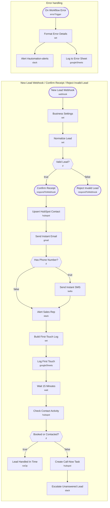

# Speed-to-Lead Instant Response

<!-- CANVAS:START -->

<!-- CANVAS:END -->

Replies to every new lead within seconds: a text and an email with your booking link, a Slack ping for the rep, and a HubSpot contact. If nobody has booked or logged a call 15 minutes later, it creates a call-now task and escalates.

Built for service businesses (accounting, insurance, real estate, agencies) where the first company to respond usually wins the client.

## What it does

1. **New Lead Webhook** receives the form submission and **Business Settings** adds your company name, booking link, Twilio number and HubSpot portal ID.
2. **Normalize Lead** cleans the payload, converts US phone numbers to +1 format and timestamps the lead. **Valid Lead?** rejects bad emails with a 400.
3. **Confirm Receipt** answers the form right away, then **Upsert HubSpot Contact** saves the lead (retries 3 times).
4. **Send Instant Email** sends a branded HTML email with a booking button. **Has Phone Number?** decides whether **Send Instant SMS** runs. **Alert Sales Rep** posts the lead to `#new-leads` with a HubSpot link. Each send retries and never blocks the others.
5. **Build First-Touch Log** records seconds-to-first-touch and **Log First Touch** writes it to a Google Sheet.
6. **Wait 15 Minutes**, then **Check Contact Activity** reads the contact's latest meeting and last-contacted dates. If neither is set, **Create Call-Now Task** adds a HubSpot task and **Escalate Unanswered Lead** nudges the team again.
7. **On Workflow Error** posts any failure to `#automation-alerts` and logs it to an error sheet.

## Sample request

```bash
curl -X POST https://YOUR-N8N/webhook/speed-to-lead \
  -H "Content-Type: application/json" \
  -d '{"firstName":"Dana","lastName":"Whitfield","email":"dana@whitfieldcpa.com","phone":"(619) 555-0142","company":"Whitfield CPA","message":"Need help automating client intake","source":"website"}'
```

## Setup

1. **Business Settings**: set company name, booking link, Twilio sender number and HubSpot portal ID.
2. **HubSpot**: connect on the three HubSpot nodes.
3. **Gmail** and **Twilio**: connect on the send nodes. Your Twilio number must be SMS-enabled (A2P 10DLC registered for US numbers).
4. **Slack**: create `#new-leads` and `#automation-alerts`, connect the Slack nodes.
5. **Google Sheets**: point **Log First Touch** at a `Speed-to-Lead Log` sheet and **Log to Error Sheet** at an error log.

Every workflow ships inactive with credential placeholders. Connect your own accounts, run one test, then activate.

---

<!-- ARCHITECTURE:START -->
## Architecture



> Shapes: rounded = trigger, hexagon = branch point. Dashed borders mark AI sub-nodes; dotted edges are the model, memory and tool connections feeding an agent. Faded nodes are disabled in this export.
<!-- ARCHITECTURE:END -->
