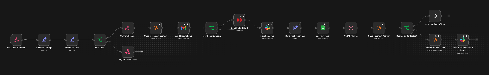
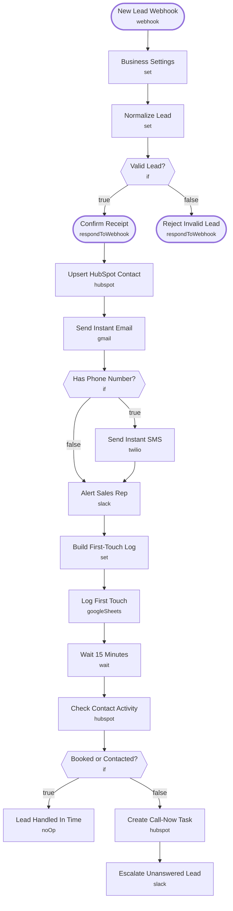

# Speed-to-Lead Instant Response

<!-- CANVAS:START -->

<!-- CANVAS:END -->

Replies to every new lead within seconds: a text and an email with your booking link, a Slack ping for the rep, and a HubSpot contact. If nobody has booked or logged a call 15 minutes later, it creates a call-now task and escalates.

Built for service businesses (accounting, insurance, real estate, agencies) where the first company to respond usually wins the client.

## What it does

1. **New Lead Webhook** (Webhook) receives the form submission, and **Business Settings** (Set) adds your company name, booking link, Twilio number and HubSpot portal ID.
2. **Normalize Lead** (Set) cleans the payload, converts US phone numbers to +1 format and timestamps the lead. **Valid Lead?** (If) sends bad emails to **Reject Invalid Lead**, which answers with a 400.
3. **Confirm Receipt** (Respond to Webhook) answers the form right away, then **Upsert HubSpot Contact** (HubSpot) saves the lead, retrying 3 times.
4. From there the flow splits three ways:
   - **Send Instant Email** (Gmail) sends a branded email with a booking button.
   - **Has Phone Number?** (If) decides whether **Send Instant SMS** (Twilio) runs.
   - **Alert Sales Rep** (Slack) posts the lead to `#new-leads` with a HubSpot link.
5. **Build First-Touch Log** (Set) records seconds-to-first-touch and **Log First Touch** (Google Sheets) writes it to a sheet.
6. **Wait 15 Minutes** (Wait), then **Check Contact Activity** (HubSpot) reads the latest meeting and last-contacted dates. **Booked or Contacted?** (If) ends at **Lead Handled In Time** if either is set; otherwise **Create Call-Now Task** (HubSpot) adds a task and **Escalate Unanswered Lead** (Slack) nudges the team again.

## Sample request

```bash
curl -X POST https://YOUR-N8N/webhook/speed-to-lead \
  -H "Content-Type: application/json" \
  -d '{"firstName":"Dana","lastName":"Whitfield","email":"dana@whitfieldcpa.com","phone":"(619) 555-0142","company":"Whitfield CPA","message":"Need help automating client intake","source":"website"}'
```

## Setup (about 15 minutes)

1. **Business Settings** — set your company name, booking link, Twilio sender number and HubSpot portal ID.
2. **HubSpot** — connect an account on **Upsert HubSpot Contact**, **Check Contact Activity** and **Create Call-Now Task**.
3. **Gmail** — connect an account on **Send Instant Email** and adjust the wording as needed.
4. **Twilio** — connect an account on **Send Instant SMS**. The number must be SMS-enabled (A2P 10DLC registered for US numbers).
5. **Slack** — connect an account on **Alert Sales Rep** and **Escalate Unanswered Lead**, and point them at your own channel (currently `#new-leads`).
6. **Google Sheets** — connect an account on **Log First Touch** and replace the placeholder document ID (`REPLACE_WITH_SPREADSHEET_ID`) with your own sheet.
7. **Error handling** — import [Workflow Error Handler](../workflow_error_handler) first, then select it under *Workflow settings → Error workflow* (shipped as `REPLACE_WITH_ERROR_WORKFLOW_ID`).

---

<!-- ARCHITECTURE:START -->
## Architecture



> Shapes: rounded = trigger, hexagon = branch point. Dashed borders mark AI sub-nodes; dotted edges are the model, memory and tool connections feeding an agent. Faded nodes are disabled in this export.
<!-- ARCHITECTURE:END -->
