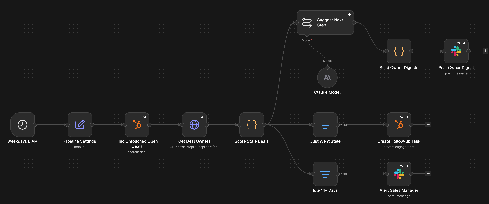
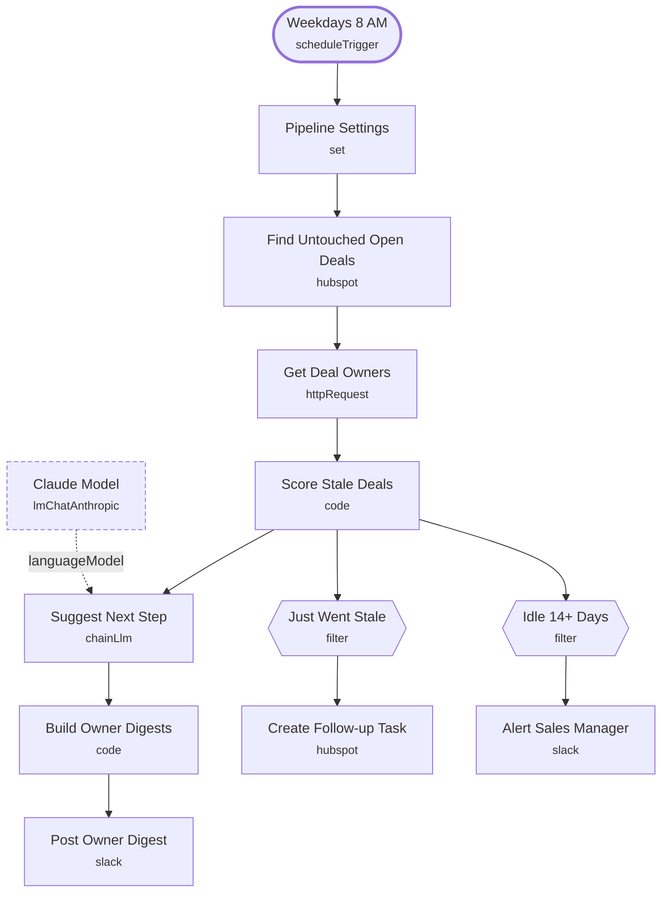

# Stale Deal Reminder

<!-- CANVAS:START -->

<!-- CANVAS:END -->

Every weekday morning it finds open HubSpot deals with no logged activity for 7+ days. Each rep gets a Slack digest with an AI-suggested next step per deal, a follow-up task is created the first time a deal goes stale, and the sales manager gets one alert for everything idle 14+ days.

Built for small sales teams where deals quietly die because nobody noticed they stopped moving.

## What it does

1. **Weekdays 8 AM** (Schedule Trigger) starts the run, and **Pipeline Settings** (Set) holds the stale and escalation thresholds.
2. **Find Untouched Open Deals** (HubSpot) searches for open deals whose last activity, or creation date if never touched, is older than the threshold. **Get Deal Owners** (HTTP Request) loads owner names once.
3. **Score Stale Deals** (Code) computes days idle, matches owners and flags newly stale and escalated deals.
4. From there the flow splits three ways:
   - **Suggest Next Step** (Basic LLM Chain with **Claude Model**) writes one action per deal, **Build Owner Digests** (Code) groups them per owner and **Post Owner Digest** (Slack) sends one message per rep to `#sales-team`.
   - **Just Went Stale** (Filter) keeps deals that crossed the threshold in the last 3 days, so **Create Follow-up Task** (HubSpot) does not duplicate tasks daily.
   - **Idle 14+ Days** (Filter) feeds **Alert Sales Manager** (Slack), one message to `#sales-managers` with the value at risk.

## Sample request

Not applicable — this workflow runs on a weekday schedule and reads from HubSpot rather than an inbound request.

## Setup (about 10 minutes)

1. **Pipeline Settings** — set the thresholds and portal ID. Keep the 7 in `staleCutoffMs` in line with `staleDays`.
2. **HubSpot** — connect an account on **Find Untouched Open Deals**, **Get Deal Owners** and **Create Follow-up Task**.
3. **Anthropic** — connect an account on **Claude Model**.
4. **Slack** — connect an account on **Post Owner Digest** and **Alert Sales Manager** (currently `#sales-team` and `#sales-managers`).
5. **Error handling** — import [Workflow Error Handler](../workflow_error_handler) first, then select it under *Workflow settings → Error workflow* (shipped as `REPLACE_WITH_ERROR_WORKFLOW_ID`).

---

<!-- ARCHITECTURE:START -->
## Architecture

> Shapes: rounded = trigger, hexagon = branch point. Dashed borders mark AI sub-nodes; dotted edges are the model, memory and tool connections feeding an agent. Faded nodes are disabled in this export.
<!-- ARCHITECTURE:END -->
