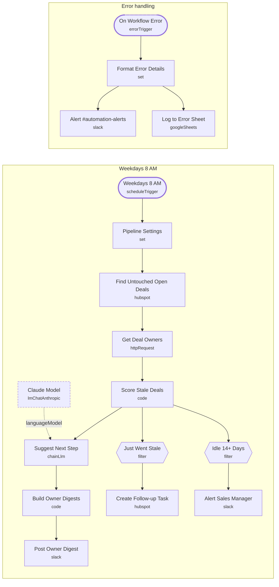

# Stale Deal Reminder

<!-- CANVAS:START -->

<!-- CANVAS:END -->

Every weekday morning it finds open HubSpot deals with no logged activity for 7+ days. Each rep gets a Slack digest with an AI-suggested next step per deal, a follow-up task is created the first time a deal goes stale, and the sales manager gets one alert for everything idle 14+ days.

Built for small sales teams where deals quietly die because nobody noticed they stopped moving.

## What it does

1. **Weekdays 8 AM** starts the run. **Pipeline Settings** holds the stale and escalation thresholds.
2. **Find Untouched Open Deals** searches HubSpot for open deals whose last activity (or creation date, if never touched) is older than the threshold. **Get Deal Owners** loads owner names once.
3. **Score Stale Deals** (Code) computes days idle, matches owners and flags newly stale and escalated deals.
4. **Suggest Next Step** (Claude) writes one concrete action per deal. **Build Owner Digests** groups them per owner and **Post Owner Digest** sends one message per rep to `#sales-team`.
5. **Just Went Stale** keeps deals that crossed the threshold in the last 3 days, so **Create Follow-up Task** does not duplicate tasks daily.
6. **Idle 14+ Days** feeds **Alert Sales Manager**, one message to `#sales-managers` with the value at risk.
7. **On Workflow Error** posts any failure to `#automation-alerts` and logs it.

## Sample request

Not applicable: runs on a weekday schedule and reads from HubSpot.

## Setup

1. **Pipeline Settings**: thresholds and portal ID. Keep the 7 in `staleCutoffMs` in line with `staleDays`.
2. Connect **HubSpot** (also on **Get Deal Owners**), **Anthropic** and **Slack**, plus **Google Sheets** for the error log.
3. Create `#sales-team`, `#sales-managers` and `#automation-alerts`.

Every workflow ships inactive with credential placeholders. Connect your own accounts, run one test, then activate.

---

<!-- ARCHITECTURE:START -->
## Architecture

> Shapes: rounded = trigger, hexagon = branch point. Dashed borders mark AI sub-nodes; dotted edges are the model, memory and tool connections feeding an agent. Faded nodes are disabled in this export.
<!-- ARCHITECTURE:END -->
