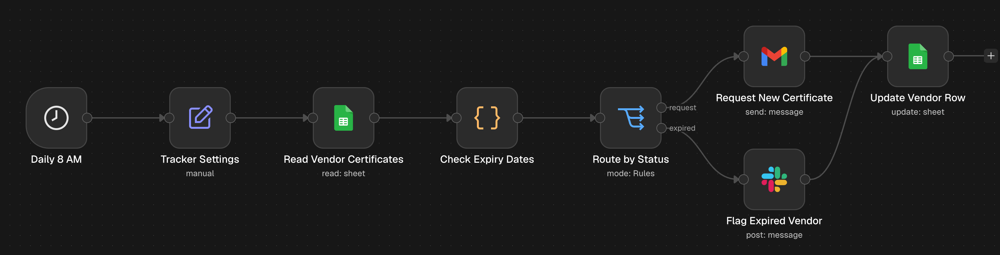
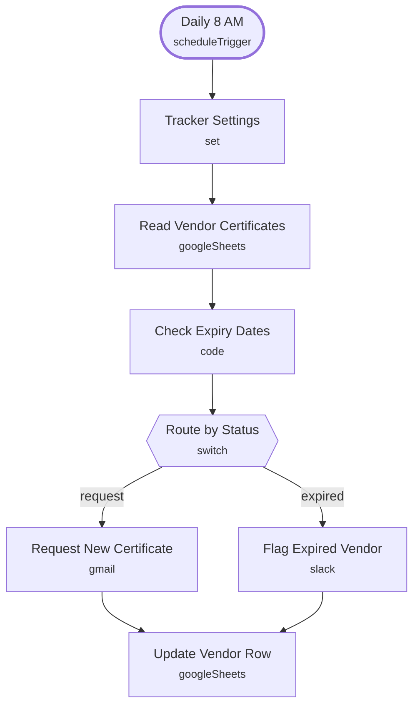

# Subcontractor Insurance Expiry Tracker

<!-- CANVAS:START -->

<!-- CANVAS:END -->

Every morning it checks the insurance certificate (COI) expiry date of every subcontractor and vendor. Vendors are asked for a renewed certificate 30, 14 and 7 days before expiry, and the site team is told in Slack not to schedule anyone whose certificate has lapsed.

Built for general contractors, builders and property managers who must not put uninsured subcontractors on site.

## What it does

1. **Daily 8 AM** (Schedule Trigger) starts the run, and **Tracker Settings** (Set) holds your company name, sender name and the address certificates should go to.
2. **Read Vendor Certificates** (Google Sheets) reads the vendor list.
3. **Check Expiry Dates** (Code) finds certificates expiring in exactly 30, 14 or 7 days, and ones that have expired but are not yet marked expired.
4. **Route by Status** (Switch) splits them:
   - **Request New Certificate** (Gmail) asks the vendor for a renewed certificate naming you as holder.
   - **Flag Expired Vendor** (Slack) posts a do-not-schedule alert to `#site-ops`.
5. **Update Vendor Row** (Google Sheets) saves the new status and the notice date, so an expired vendor is flagged only once.

## Sample request

Not applicable — this workflow runs on a schedule and reads from a Google Sheet of vendor certificates rather than an inbound request.

## Setup (about 10 minutes)

1. **Google Sheets** — connect an account on **Read Vendor Certificates** and **Update Vendor Row**, and replace the placeholder document ID (`REPLACE_WITH_SPREADSHEET_ID`) with a sheet with the columns `vendorName`, `contactName`, `email`, `policyType`, `expiryDate`, `status`, `lastNotice`.
2. **Tracker Settings** — set your company name, sender name and certificate inbox.
3. **Gmail** — connect an account on **Request New Certificate**.
4. **Slack** — connect an account on **Flag Expired Vendor** and point it at your own channel (currently `#site-ops`).
5. **Error handling** — import [Workflow Error Handler](../workflow_error_handler) first, then select it under *Workflow settings → Error workflow* (shipped as `REPLACE_WITH_ERROR_WORKFLOW_ID`).

---

<!-- ARCHITECTURE:START -->
## Architecture

> Shapes: rounded = trigger, hexagon = branch point. Dashed borders mark AI sub-nodes; dotted edges are the model, memory and tool connections feeding an agent. Faded nodes are disabled in this export.
<!-- ARCHITECTURE:END -->
