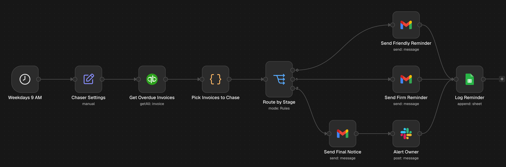
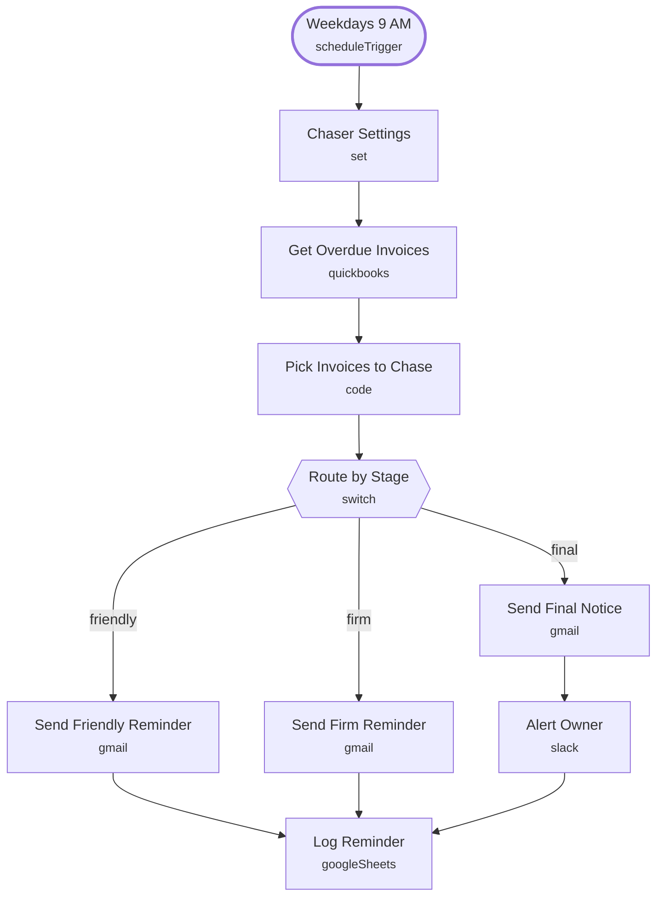

# Unpaid Invoice Chaser

<!-- CANVAS:START -->

<!-- CANVAS:END -->

Every weekday morning it pulls overdue invoices from QuickBooks Online and emails each customer a reminder that gets firmer the longer the invoice stays unpaid. Final notices also alert the owner in Slack, and every reminder is logged.

Built for service businesses, agencies and professional firms that lose cash to invoices nobody has time to chase.

## What it does

1. **Weekdays 9 AM** (Schedule Trigger) starts the run, and **Chaser Settings** (Set) holds your sender name and payment instructions.
2. **Get Overdue Invoices** (QuickBooks Online) fetches every invoice with a balance past its due date.
3. **Pick Invoices to Chase** (Code) keeps invoices that are 1, 7 or 14 days overdue, then every 7 days after that, skips any without an email address, and sets the stage: friendly (under 7 days), firm (7 to 20) or final (21+).
4. **Route by Stage** (Switch) sends each invoice down one of three paths:
   - **Send Friendly Reminder** (Gmail) for a light nudge.
   - **Send Firm Reminder** (Gmail) asking for payment this week.
   - **Send Final Notice** (Gmail), then **Alert Owner** (Slack) posts to `#accounts-receivable` so someone picks up the phone.
5. **Log Reminder** (Google Sheets) records every reminder sent.

## Sample request

Not applicable — this workflow runs on a weekday schedule and reads from QuickBooks Online rather than an inbound request.

## Setup (about 10 minutes)

1. **QuickBooks Online** — connect an account on **Get Overdue Invoices**. Customers need a billing email on their invoices.
2. **Chaser Settings** — set your sender name and payment instructions.
3. **Gmail** — connect an account on the three send nodes and adjust the wording as needed.
4. **Slack** — connect an account on **Alert Owner** and point it at your own channel (currently `#accounts-receivable`).
5. **Google Sheets** — connect an account on **Log Reminder** and replace the placeholder document ID (`REPLACE_WITH_SPREADSHEET_ID`) with a log sheet.
6. **Error handling** — import [Workflow Error Handler](../workflow_error_handler) first, then select it under *Workflow settings → Error workflow* (shipped as `REPLACE_WITH_ERROR_WORKFLOW_ID`).

---

<!-- ARCHITECTURE:START -->
## Architecture

> Shapes: rounded = trigger, hexagon = branch point. Dashed borders mark AI sub-nodes; dotted edges are the model, memory and tool connections feeding an agent. Faded nodes are disabled in this export.
<!-- ARCHITECTURE:END -->
