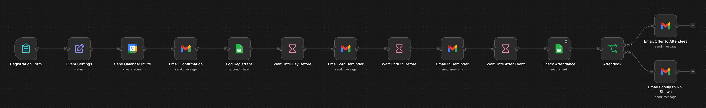
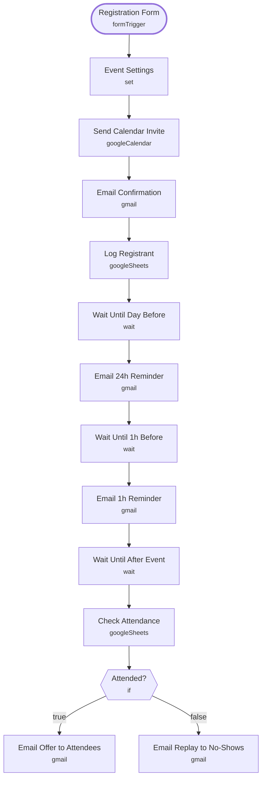

# Webinar Registration & No-Show Replay

<!-- CANVAS:START -->

<!-- CANVAS:END -->

A registration form signs people up for a live session, sends a Google Calendar invite and a confirmation, then reminds them 24 hours and 1 hour before. After the event, attendees get the replay plus a call-booking offer, and no-shows get the replay with a softer nudge.

Built for coaches, course creators and B2B marketing teams running webinars without a paid webinar platform.

## What it does

1. **Registration Form** (Form Trigger) collects first name, email and company.
2. **Event Settings** (Set) holds the title, host, start time, length, join link, replay link and offer link.
3. **Send Calendar Invite** (Google Calendar) creates the event with the registrant as a guest, **Email Confirmation** (Gmail) confirms, and **Log Registrant** (Google Sheets) adds them to the list.
4. **Wait Until Day Before** (Wait) and **Email 24h Reminder** (Gmail), then **Wait Until 1h Before** (Wait) and **Email 1h Reminder** (Gmail).
5. **Wait Until After Event** (Wait) holds until 2 hours after the end, then **Check Attendance** (Google Sheets) reads the registrant's row.
6. **Attended?** (If) chooses the follow-up:
   - **Email Offer to Attendees** (Gmail) with the replay and a call-booking link.
   - **Email Replay to No-Shows** (Gmail) with the replay.

## Sample request

Not applicable — people register through the hosted n8n form at `/form/webinar-register`.

## Setup (about 15 minutes)

1. **Event Settings** — set the title, host, start time (ISO, with time zone), length and the three links.
2. **Google Calendar** — connect an account on **Send Calendar Invite**.
3. **Gmail** — connect an account on the five email nodes.
4. **Google Sheets** — connect an account on **Log Registrant** and **Check Attendance**, and replace the placeholder document ID (`REPLACE_WITH_SPREADSHEET_ID`) with a sheet with the columns `registeredAt`, `firstName`, `email`, `company`, `attended`. After the session, type `yes` in `attended` for everyone who showed up (or paste your meeting tool's attendee export).
5. **Form** — activate the workflow and share the form URL from **Registration Form**.
6. **Error handling** — import [Workflow Error Handler](../workflow_error_handler) first, then select it under *Workflow settings → Error workflow* (shipped as `REPLACE_WITH_ERROR_WORKFLOW_ID`).

---

<!-- ARCHITECTURE:START -->
## Architecture

> Shapes: rounded = trigger, hexagon = branch point. Dashed borders mark AI sub-nodes; dotted edges are the model, memory and tool connections feeding an agent. Faded nodes are disabled in this export.
<!-- ARCHITECTURE:END -->
