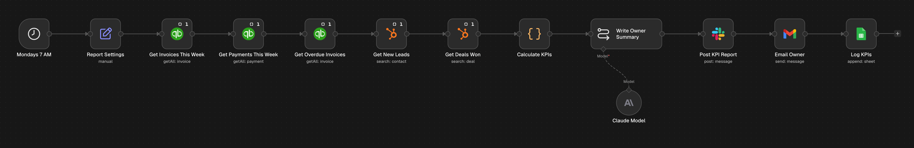
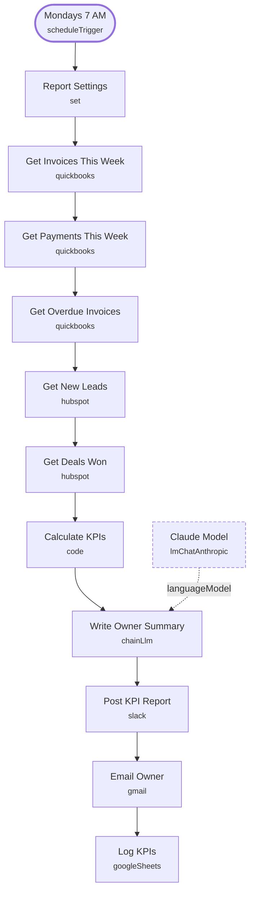

# Weekly Owner KPI Report

<!-- CANVAS:START -->

<!-- CANVAS:END -->

Every Monday morning it pulls last week's numbers from QuickBooks Online and HubSpot (invoiced, collected, overdue, new leads and deals won), has Claude write a three-sentence note on what needs attention, and posts it to Slack and the owner's inbox. Each week is logged for trends.

Built for small-business owners who want one page of numbers on Monday instead of logging into four tools.

## What it does

1. **Mondays 7 AM** (Schedule Trigger) starts the run, and **Report Settings** (Set) works out the week's start date and holds the owner email and weekly revenue goal.
2. **Get Invoices This Week**, **Get Payments This Week** and **Get Overdue Invoices** (QuickBooks Online) fetch the money side.
3. **Get New Leads** and **Get Deals Won** (HubSpot) fetch the sales side.
4. **Calculate KPIs** (Code) totals everything and compares collections with the goal.
5. **Write Owner Summary** (Basic LLM Chain with **Claude Model**) writes a short note: what went well, what needs attention and one action for the week.
6. **Post KPI Report** (Slack) posts to `#leadership`, **Email Owner** (Gmail) sends the same note, and **Log KPIs** (Google Sheets) adds a row for the week.

## Sample request

Not applicable — this workflow runs every Monday and reads from QuickBooks Online and HubSpot rather than an inbound request.

## Setup (about 10 minutes)

1. **Report Settings** — set your business name, owner email and weekly revenue goal.
2. **QuickBooks Online** — connect an account on the three QuickBooks nodes.
3. **HubSpot** — connect an account on **Get New Leads** and **Get Deals Won**.
4. **Anthropic** — connect an account on **Claude Model**.
5. **Slack** — connect an account on **Post KPI Report** (currently `#leadership`).
6. **Gmail** — connect an account on **Email Owner**.
7. **Google Sheets** — connect an account on **Log KPIs** and replace the placeholder document ID (`REPLACE_WITH_SPREADSHEET_ID`).
8. **Error handling** — import [Workflow Error Handler](../workflow_error_handler) first, then select it under *Workflow settings → Error workflow* (shipped as `REPLACE_WITH_ERROR_WORKFLOW_ID`).

---

<!-- ARCHITECTURE:START -->
## Architecture

> Shapes: rounded = trigger, hexagon = branch point. Dashed borders mark AI sub-nodes; dotted edges are the model, memory and tool connections feeding an agent. Faded nodes are disabled in this export.
<!-- ARCHITECTURE:END -->
