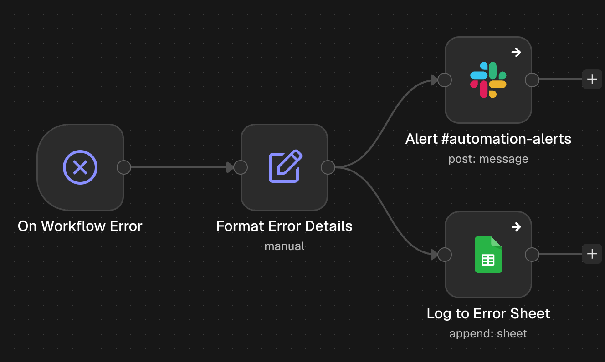
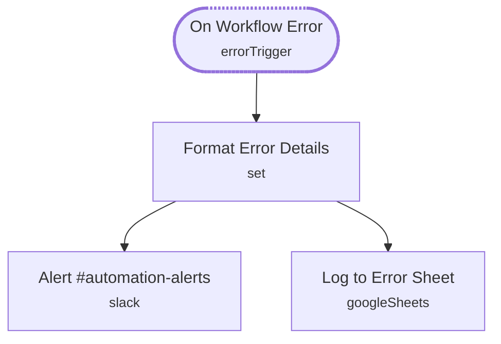

# Workflow Error Handler

<!-- CANVAS:START -->

<!-- CANVAS:END -->

Catches a failed run from any workflow that points to it, posts the details to Slack and writes a row to an error log sheet, so a broken automation never fails silently.

Built to be shared by every workflow in the lead & sales set (and any other workflow you add), so error alerts live in one place.

## What it does

1. **On Workflow Error** (Error Trigger) runs whenever a workflow that uses this as its error workflow fails.
2. **Format Error Details** (Set) pulls out the workflow name, failed node, error message, execution link and time.
3. From there the flow splits two ways:
   - **Alert #automation-alerts** (Slack) posts the details to your alerts channel.
   - **Log to Error Sheet** (Google Sheets) appends a row to the error log.

## Sample request

Not applicable — n8n starts this workflow automatically when a linked workflow fails.

## Setup (about 5 minutes)

1. **Slack** — connect an account on **Alert #automation-alerts** and point it at your own channel (currently `#automation-alerts`).
2. **Google Sheets** — connect an account on **Log to Error Sheet** and replace the placeholder document ID (`REPLACE_WITH_SPREADSHEET_ID`) with your error log.
3. **Link workflows** — in each workflow, open *Workflow settings → Error workflow* and select **Workflow Error Handler**.

---

<!-- ARCHITECTURE:START -->
## Architecture

> Shapes: rounded = trigger, hexagon = branch point. Dashed borders mark AI sub-nodes; dotted edges are the model, memory and tool connections feeding an agent. Faded nodes are disabled in this export.
<!-- ARCHITECTURE:END -->
